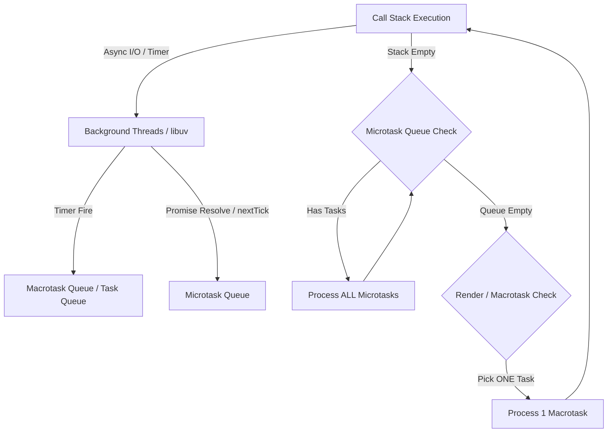

## The Problem

Node.js application တစ်ခုမှာ HTTP Request တစ်ခုက ရေရှည်ကြာမြင့်မည့် Synchronous CPU task (ဥပမာ- 50MB JSON ကို `JSON.parse` လုပ်ခြင်း သို့မဟုတ် Array တန်ဖိုး 10 Million ကို Filter လုပ်ခြင်း) ကို လုပ်ဆောင်လိုက်ပါက Server တစ်ခုလုံး တုံ့ပြန်မှု ရပ်ဆိုင်းသွားပါသည်။ API ၏ P99 latency သည် 15ms မှ 3000ms သို့ ရုတ်တရက် ခုန်တက်သွားပြီး ကျန်ရှိသော HTTP Connection များအားလုံး Timeout ဖြစ်ကုန်မည်။

JavaScript သည် Single-threaded runtime ဖြစ်သည်။ Thread တစ်ခုတည်းဖြင့် Execute လုပ်သောကြောင့် CPU-bound operation များ လုပ်ဆောင်နေချိန်တွင် တခြား မည်သည့် I/O Event မှ မလုပ်ဆောင်နိုင်ပါ။

`async/await` ကို သုံးထားရုံဖြင့် Multi-threading ဖြစ်မသွားပါ။ Developer အများစုသည် `async/await` ကို Background Thread တွင် သီးသန့် အလုပ်လုပ်ပေးသည်ဟု မှားယွင်းစွာ ယူဆတတ်ကြသည်။ Event Loop ၏ အလုပ်လုပ်ပုံ Mechanism ကို သေချာ မသိပါက Production System တွင် Starvation နှင့် High Latency ပြဿနာများကို ဖြေရှင်းနိုင်မည် မဟုတ်ပါ။

## How It Works

Event Loop ဆိုသည်မှာ Call Stack၊ Task Queue (Macrotask) နှင့် Microtask Queue တို့အကြား Workload များကို စီမံခန့်ခွဲပေးသည့် Infinite Loop တစ်ခုဖြစ်သည်။ ၎င်းသည် Single Thread ပေါ်တွင် Blocking မဖြစ်ဘဲ Non-blocking I/O ကို မည်သို့ စီမံသည်ဆိုသော Architecture ဖြစ်သည်။



Event Loop ၏ Lifecycle Phase များအား အောက်ပါအတိုင်း အဆင့်ဆင့် အလုပ်လုပ်သည်။

1. **Call Stack**: JavaScript Code များ တန်းစီ၍ Synchronous အတိုင်း အလုပ်လုပ်သည်။ Stack ထဲတွင် Code များ ရှိနေသရွေ့ Event Loop သည်။ စောင့်ဆိုင်းနေရသည်။
2. **Node APIs / libuv Thread Pool**: Async I/O (File System, Network Call, Timer) များကို Engine က C++ Binding (libuv) ထံ လွှဲပေးလိုက်ပြီး Main Thread ကို Blocking မဖြစ်စေရန် လွှတ်ပေးလိုက်သည်။
3. **Microtask Queue**: `Promise.then()`, `async/await`, `queueMicrotask()`, နှင့် Node.js ၏ `process.nextTick()` စသည်တို့ တည်ရှိသည်။ **အဓိကအချက်မှာ မည်သည့် Macrotask သို့ မကူးမီ Microtask Queue ထဲရှိ Task အားလုံး ကုန်သည်အထိ ရှင်းလင်းပေးရသည်။**
4. **Macrotask Queue (Task Queue)**: `setTimeout`, `setInterval`, `setImmediate`, I/O Callbacks စသည်တို့ တည်ရှိသည်။ Loop တစ်ပတ်လျှင် Macrotask **တစ်ခုတည်း** ကိုသာ ယူ၍ Call Stack သို့ တင်ပေးပြီး Executed လုပ်သည်။

## Implementation

Event Loop ၏ Queue ဦးစားပေးစနစ် (Priority Order) နှင့် Execution Order ကို သိရှိနိုင်ရန် အောက်ပါ Production Simulation Code ကို လေ့လာကြည့်ပါမည်။

### Example 1: Task Priority Order Architecture Simulation

```typescript
import { performance } from 'perf_hooks';

function logWithTime(msg: string): void {
  // Production latency monitoring format
  const time = performance.now().toFixed(2);
  console.log(`[${time}ms] ${msg}`);
}

logWithTime('1. Synchronous Code: setTimeout (Timer Queue)');
}, 0);

// Macrotask: Check Queue (Node.js specific)
setImmediate(() => {
  logWithTime('3. Macrotask: setImmediate (Check Queue)');
});

// Microtask: Microtask Queue (Promises)
Promise.resolve().then(() => {
  logWithTime('4. Microtask: Promise Resolution');
});

// Microtask Queue (Process Tick - Highest Priority in Node.js)
process.nextTick(() => {
  logWithTime('5. Microtask: process.nextTick');
});

logWithTime('6. Synchronous Code End');
```

**Output နှင့် အသေးစိတ်ရှင်းလင်းချက်:**

```text
[0.12ms] 1. Synchronous Code Start
[0.45ms] 6. Synchronous Code End
[0.60ms] 5. Microtask: process.nextTick
[0.72ms] 4. Microtask: Promise Resolution
[1.85ms] 2. Macrotask: setTimeout (Timer Queue)
[1.98ms] 3. Macrotask: setImmediate (Check Queue)
```

- **`process.nextTick` ၏ သဘောသဘာဝ**: Node.js တွင် `process.nextTick` သည် သာမန် Promise Microtask များထက် ဦးစားပေး အဆင့်မြင့်သည်။ ထို့ကြောင့် Promise ရဲ့ `then()` ထက် အရင် Run သည်။
- **Microtask Execution Complete**: Synchronous code ရော Microtask Queue ရှိ task များ ကုန်မှသာ Timer များ (`setTimeout`) ကို Event Loop က အလုပ်လုပ်ပေးသည်။

---

### Example 2: Offloading Heavy CPU Operations (Yielding to Event Loop)

အကယ်၍ Array အကွက်ရေ 10 Million ကို Process လုပ်ရလျှင် Loop တစ်ခုတည်းဖြင့် Run ပါက Event Loop စောင့်ဆိုင်းသွားမည် ဖြစ်သည်။ ယင်းကို Macrotask များအဖြစ် Chunk ခွဲ၍ Event Loop ထံ **Yield** သွားသည့် Pattern ဖြစ်သည်။

```typescript
// Big Payload Processing without freezing the Event Loop
async function processLargeArrayChunked<T>(
  items: T[],
  chunkSize: number,
  processor: (item: T) => void
): Promise<void> {
  let index = 0;

  return new Promise((resolve) => {
    function doChunk() {
      const start = performance.now();

      // Process up to chunkSize, or yield if taking longer than 16ms (1 Frame Budget)
      while (index < items.length && (performance.now() - start) < 16) {
        processor(items[index]);
        index++;
      }

      if (index < items.length) {
        // Yield execution back to the Event Loop to process pending I/O & HTTP Requests
        // setImmediate allows Node.js to poll I/O before continuing the next chunk
        setImmediate(doChunk);
      } else {
        resolve();
      }
    }

    doChunk();
  });
}

// Execution test
const heavyDataset = new Array(5_000_000).fill(42);

console.log('Processing heavy job asynchronously...');
processLargeArrayChunked(heavyDataset, 50000, (num) => {
  // Simulate lightweight computation
  Math.sqrt(num);
}).then(() => {
  console.log('Heavy job completed without starving HTTP traffic.');
});
```

- **`performance.now() < 16`**: 16ms မကျော်စေဘဲ Chunk များခွဲ၍ လုပ်ဆောင်ခြင်းဖြင့် Event Loop ကို Non-blocking အနေအထားတွင် အမြဲ ထိန်းသိမ်းပေးထားသည်။
- **`setImmediate` ကို သုံးရသည့် အကြောင်းအရင်း**: Microtask (`queueMicrotask`) သို့မဟုတ် `Promise` ကို မသုံးဘဲ `setImmediate` ကို သုံးခြင်းမှာ မလိုအပ်ဘဲ Microtask Queue မပြည့်စေရန်နှင့် I/O Event များကို ကြားထဲတွင် အလုပ်လုပ်ခွင့် ပေးနိုင်ရန်ဖြစ်သည်။

## Trade-offs & When to Use This

| Factor | Event Loop Non-blocking (Single Thread) | Worker Threads (`worker_threads`) | Synchronous Execution |
| :--- | :--- | :--- | :--- |
| **Performance (I/O Bound)** | **အမြင့်ဆုံး** (Memory footprint နည်းပြီး Context Switch မရှိ) | အလတ်စား (Thread overhead ကြောင့် Memory ပိုစားသည်) | အနိမ့်ဆုံး (I/O Wait ကြောင့် Thread ရပ်နေသည်) |
| **Performance (CPU Bound)** | အနိမ့်ဆုံး (Main Thread ကို Block ဖြစ်စေသည်) | **အမြင့်ဆုံး** (CPU Core များကို သီးသန့် အသုံးချနိုင်သည်) | အနိမ့်ဆုံး (ခေါ်ယူသူ အားလုံး လိုင်းစီစောင့်ရသည်) |
| **Complexity** | ရှင်းလင်းသည်။ Callbacks / Promises သာ သုံးရန်လိုသည်။ | ရှုပ်ထွေးသည်။ Thread IPC (Inter-Process Comms) ဖြင့် Data ပို့ရသည်။ | အရှင်းဆုံးဖြစ်သည်။ Sequential အတိုင်း ရေးရုံပင်။ |
| **Scalability** | High Concurrency (100k+ concurrent connection စီမံနိုင်) | Limited by CPU Cores count | Low Concurrency |

## Edge Cases & Failure Modes

Production တွင် Event Loop ကြောင့် အဖြစ်များဆုံး Downtime Issue များနှင့် ကာကွယ်နည်းများမှာ -

### 1. Microtask Queue Starvation (Infinite Promise Loops)
အကယ်၍ Microtask တစ်ခုက အခြား Microtask တစ်ခုကို အဆုံးမရှိ ဆက်တိုက် Generate လုပ်နေပါက Event Loop သည် Macrotask သို့မဟုတ် I/O Queue များသို့ မရောက်တော့ပေ။

```typescript
// Dangerous Anti-Pattern: Starves the Event Loop completely!
function recursiveMicrotask() {
  Promise.resolve().then(() => {
    // Microtask Queue will NEVER be empty.
    // HTTP Server will stop accepting new requests, Timers won't fire.
    recursiveMicrotask();
  });
}
```
**Solution**: တကယ့် Async/Background Task များအတွက် Microtask အစား `setImmediate()` ကို အသုံးပြုပါ။

### 2. Node.js `process.nextTick` Recursion
`process.nextTick` သည် Node.js တွင် Microtask ထက်ပင် ဦးစားပေး အဆင့်မြင့်သောကြောင့် recursive ခေါ်ယူပါက I/O Starvation ရုတ်တရက် ဖြစ်ပေါ်စေသည်။ Node.js runtime က `Maximum call stack exceeded` မပြမီ ရုတ်တရက် Freeze ဖြစ်သွားတတ်သည်။

### 3. Blocking synchronously inside Async wrappers
```typescript
app.get('/api/data', async (req, res) => {
  // async keyword ပါသော်လည်း JSON.parse သည် synchronous ဖြစ်သဖြင့်
  // Payload ကြီးလွန်းပါက Main Thread ကို Block လုပ်သွားမည်။
  const data = JSON.parse(hugeBufferPayload); 
  res.send(data);
});
```
**Solution**: ကြီးမားသော Payload များအတွက် Stream JSON Parser (ဥပမာ `stream-json`) ကို သုံးပါ သို့မဟုတ် Payload Processing ကို `worker_threads` သို့ ခွဲထုတ်ပါ။

## Key Takeaways

* **JavaScript သည် Thread တစ်ခုတည်းပေါ်တွင်သာ Run သည်။** `async/await` သည် Synchronous Code ကို Magic ဆန်ဆန် Multi-thread ဖြစ်မသွားစေပါ။
* **Microtask များသည် Macrotask ထက် ဦးစားပေး အမြဲမြင့်သည်။** Loop တစ်ပတ်တိုင်းတွင် Microtask Queue ထဲရှိ Task အားလုံး ရှင်းလင်းပြီးမှသာ Timer သို့မဟုတ် I/O ကို ဆက်လက် အလုပ်လုပ်သည်။
* **CPU-bound tasks များကို Main Thread ပေါ်တွင် မလုပ်ဆောင်ပါနှင့်။** Heavy Computation များအတွက် `worker_threads` သို့မဟုတ် Event Loop ထံ Yield သည့် Chunking Strategy များကို သုံးပါ။
* **`process.nextTick()` နှင့် Recursive Promise များကို သတိထားပါ။** ယင်းတို့သည် Microtask Queue တွင် Starvation ဖြစ်စေပြီး I/O ၊ Timer များနှင့် Network Connection များကို ပိတ်ဆို့သွားစေနိုင်သည်။