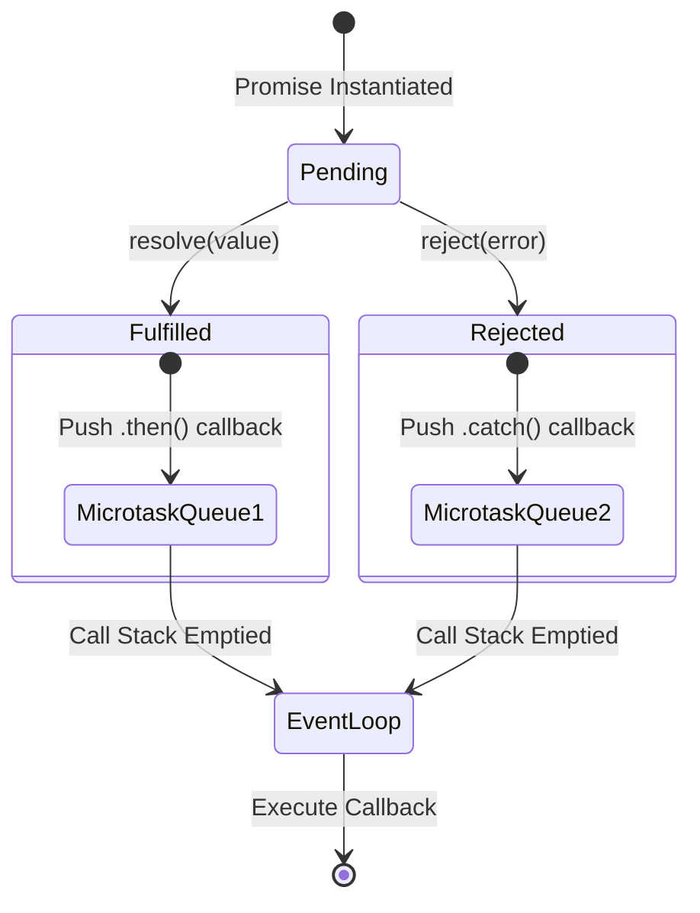

## The Problem

JavaScript သည် Single-threaded runtime တစ်ခုဖြစ်သောကြောင့် Network Request များ သို့မဟုတ် File I/O များကို Synchronous အတိုင်း စောင့်ဆိုင်းပါက Main Thread တစ်ခုလုံး Freeze ဖြစ်သွားပြီး UI ရပ်တန့်သွားမည်ဖြစ်သည်။ ဤပြဿနာကို ဖြေရှင်းရန် အစောပိုင်း JavaScript တွင် Asynchronous logic များကို Callbacks များနှင့်သာ ရေးသားခဲ့ကြသည်။ သို့သော် Asynchronous logic များ ရှုပ်ထွေးလာသည်နှင့်အမျှ "Callback Hell" သို့မဟုတ် "Pyramid of Doom" ဟုခေါ်သော ဖတ်ရခက်ခဲပြီး Maintain လုပ်ရခက်သည့် Code Architecture သို့ ရောက်ရှိသွားသည်။

ပိုမိုဆိုးရွားသည်မှာ Callbacks များသည် "Inversion of Control" ပြဿနာကို ဖြစ်ပေါ်စေခြင်းဖြစ်သည်။ သင့် Code ၏ ထိန်းချုပ်ခွင့်ကို Third-party Library တစ်ခုခုထဲသို့ လွှဲပြောင်းပေးလိုက်ရပြီး၊ ထို Library က Callback ကို နှစ်ကြိမ် ခေါ်လိုက်သလား၊ သို့မဟုတ် လုံးဝ မခေါ်ဘဲ ပစ်ထားသလား ဆိုသည်ကို သင် ထိန်းချုပ်၍ မရနိုင်တော့ပေ။

ထို့အပြင် Synchronous `try-catch` block များသည် Asynchronous Callbacks အတွင်း၌ ဖြစ်ပေါ်သော Runtime Errors များကို ဖမ်းယူနိုင်ခြင်း မရှိပါ။ Callback ခေါ်ယူချိန်တွင် မူလ Call Stack သည် ပွင့်ထွက် (Unwind) သွားပြီးဖြစ်သောကြောင့် Error Handling logic များသည် နေရာအနှံ့ ပရမ်းပတာ ဖြစ်ကျန်ခဲ့ပြီး Production App များ Uncaught Exception ကြောင့် Crash ဖြစ်သည့် ပြဿနာများကို ဖြစ်ပေါ်စေသည်။

## How It Works

JavaScript Promise ဆိုသည်မှာ အနာဂတ်တွင် ရရှိလာမည့် Value သို့မဟုတ် Failure Reason အတွက် Container (Proxy Object) တစ်ခုဖြစ်သည်။ Promise တစ်ခုတွင် တိကျသော State ၃ ခုအနက် တစ်ခုခုသာ ရှိနိုင်သည်။ ၎င်းတို့မှာ `pending` (စတင်ချိန်)၊ `fulfilled` (အောင်မြင်စွာ ပြီးဆုံးချိန်) နှင့် `rejected` (ကျရှုံးချိန်) တို့ဖြစ်ကြသည်။ State Transition သည် တင်းကျပ်စွာ တစ်ကြောင်းသွား (Immutable) ဖြစ်သည် — `pending` မှ `fulfilled` သို့မဟုတ် `rejected` သို့ တစ်ကြိမ်သာ ပြောင်းလဲနိုင်ပြီး ပြောင်းလဲပြီးပါက ထို State တွင် အပြီးသတ် စွဲမြဲသွားသည်။

Promise ၏ အဓိက စွမ်းအားသည် JavaScript ၏ Event Loop အောက်ရှိ Microtask Queue တွင် အလုပ်လုပ်ခြင်းဖြစ်သည်။ Synchronous Executor Function ချက်ချင်း run ပြီးနောက်၊ `.then()`, `.catch()`, သို့မဟုတ် `.finally()` စသည့် Reaction Callbacks များကို Event Loop ၏ Microtask Queue သို့ ပို့ပေးသည်။ Microtask Queue သည် Timer များ (Macrotask Queue) ထက် Priority ပိုမြင့်သောကြောင့် Current Call Stack လွတ်သွားသည်နှင့် `setTimeout` ထက် စော၍ ချက်ချင်း Execution လှမ်းလုပ်သည်။



Diagram တွင် မြင်တွေ့ရသည့်အတိုင်း `new Promise()` ဖန်တီးလိုက်သည်နှင့် State သည် `Pending` အဖြစ် စတင်သည်။ Executor Function အတွင်းမှ `resolve()` သို့မဟုတ် `reject()` ခေါ်ယူလိုက်သောအခါ State ပြောင်းလဲသွားပြီး သက်ဆိုင်ရာ `.then()` သို့မဟုတ် `.catch()` များကို Microtask Queue သို့ Schedule လုပ်လိုက်သည်။ Event Loop သည် Synchronous Call Stack အားလုံး ရှင်းလင်းသွားသည်အထိ စောင့်ပြီးမှ Microtask Queue အား ပထမ ဦးစားပေးအနေဖြင့် ဆွဲထုတ်၍ Execution ပြုလုပ်သည်။

## Implementation

Production တွင် Fetch API ကို သုံးသည့်အခါ Timeout မရှိခြင်းနှင့် Network Intermittent ဖြစ်ပါက စောင့်ဆိုင်းနေရခြင်းတို့ကို ကာကွယ်ရန် `Promise.race` နှင့် Retries Pattern ကို ပေါင်းစပ်အသုံးပြုရသည်။

အောက်ပါ Code သည် Custom Timeout နှင့် Exponential Backoff ပါဝင်သော Production-ready Network Request Wrapper ဖြစ်သည်:

```typescript
interface RequestOptions extends RequestInit {
  timeoutMs?: number;
  retries?: number;
}

// Timeout အား သတ်မှတ်ချိန်ထက် ကျော်လွန်ပါက Reject လုပ်ပေးမည့် Helper
function createTimeout(ms: number): Promise<never> {
  return new Promise((_, reject) => {
    // Unref သို့မဟုတ် clearTimeout လုပ်နိုင်ရန် Timer ID သိမ်းဆည်းရန်လိုအပ်သော်လည်း 
    // မူလ Concept ပြသရန်အတွက် Reject သာ တိုက်ရိုက်လုပ်ဆောင်ထားသည်
    setTimeout(() => {
      reject(new Error(`Request timed out after ${ms}ms`));
    }, ms);
  });
}

export async function fetchWithRetryAndTimeout(
  url: string,
  options: RequestOptions = {}
): Promise<Response> {
  const { timeoutMs = 5000, retries = 3, ...fetchOptions } = options;

  let lastError: Error | null = null;

  for (let attempt = 0; attempt < retries; attempt++) {
    try {
      // Promise.race ဖြင့် Fetch Operation နှင့် Timeout အပြိုင်ယှဉ်ပြိုင်စေသည်
      // မည်သည့် Promise က ပထမဦးစွာ Settle ဖြစ်မည်ကို ယူမည်
      const response = await Promise.race([
        fetch(url, fetchOptions),
        createTimeout(timeoutMs)
      ]);

      if (!response.ok) {
        throw new Error(`HTTP Error Status: ${response.status}`);
      }

      return response; // အောင်မြင်ပါက တိုက်ရိုက် Return ပြန်သည်
    } catch (err) {
      lastError = err as Error;
      
      // နောက်ဆုံးအကြိမ် Retries ဖြစ်ပါက ဆက်မစောင့်တော့ဘဲ Loop ကို ရပ်မည်
      if (attempt === retries - 1) break;

      // Exponential Backoff: Attempt များလာသည်နှင့်အမျှ စောင့်ဆိုင်းချိန် 2^attempt ဖြင့် တိုးသွားမည်
      // Network Thundering Herd Problem ကို ကာကွယ်ရန်ဖြစ်သည်
      const delay = Math.pow(2, attempt) * 1000;
      await new Promise((resolve) => setTimeout(resolve, delay));
    }
  }

  throw lastError || new Error('Network request failed');
}
```

အထက်ပါ Implementation တွင် `Promise.race` ကို အသုံးပြု၍ Timeout Promise နှင့် Actual Fetch Promise ကို အပြိုင် မောင်းနှင်ထားသည်။ `fetch` သည် တုံ့ပြန်မှု မြန်ပါက Timeout Error ကို ကျော်လွန်ပြီး Data ရရှိမည်ဖြစ်ပြီး၊ Network ကြာမြင့်နေပါက Timeout Promise က အရင် `reject` ဖြစ်ကာ ထိန်းချုပ်ခွင့်ကို ရယူသွားမည်ဖြစ်သည်။

## Trade-offs & When to Use This

| Factor | Native Promises / Async-Await | Callbacks | RxJS (Observables) |
| :--- | :--- | :--- | :--- |
| **Performance** | Microtask Overhead အနည်းငယ်ရှိသော်လည်း Modern Engine များတွင် Highly Optimized ဖြစ်သည်။ | Performance အမြင့်ဆုံး (Abstraction အနည်းဆုံးဖြစ်သောကြောင့်)။ | Memory/CPU Overhead အမြင့်ဆုံး (Heavy Abstraction)။ |
| **Complexity** | ရှင်းလင်းပြီး Linear Control Flow ဖြင့် ရေးသားနိုင်သည်။ | Nested တိုးလာသည်နှင့်အမျှ Cognitive Load အလွန်မြင့်မားသည်။ | Reactive Mental Model လိုအပ်သဖြင့် Learning Curve အလွန်မြင့်သည်။ |
| **Scalability** | Single Values သို့မဟုတ် One-off Async Operations အတွက် အကောင်းဆုံး။ | Scale လုပ်ရန် မဖြစ်နိုင်ပါ။ Maintenance Debt မြင့်မားသည်။ | Event Streams ( multiple values over time) များကို စီမံရန် အကောင်းဆုံး။ |

## Edge Cases & Failure Modes

 Production စနစ်များတွင် Promise အသုံးပြုရာ၌ အဖြစ်များဆုံး လွဲမှားမှုများနှင့် Failure Modes များမှာ အောက်ပါအတိုင်း ဖြစ်ကြသည်:

1. **The Async Executor Anti-Pattern**: 
   `new Promise(async (resolve, reject) => { ... })` ဟု ရေးသားခြင်းဖြစ်သည်။ Executor function ကို `async` ပေးလိုက်ပါက ၎င်းအတွင်း၌ Synchronous Error ဖြစ်ပွားပါက Promise ၏ `reject` ထံသို့ စနစ်တကျ မရောက်ဘဲ Unhandled Promise Rejection အဖြစ် ပြင်ပသို့ ထွက်သွားပြီး Node.js Process ကို Crash ဖြစ်စေနိုင်သည်။

2. **`Promise.all` ၏ Fast-Failure Trap**:
   API Call ၁၀၀ ကို အပြိုင် ခေါ်ယူရန် `Promise.all` သုံးသည့်အခါ ၁ ခု မြောက် Request ကျရှုံးပါက ကျန် ၉၉ ခု၏ အောင်မြင်သော Data များကိုပါ လွှင့်ပစ်လိုက်ပြီး `Promise.all` တစ်ခုလုံး ချက်ချင်း Reject ဖြစ်သွားသည်။ Partial Success များ လိုအပ်ပါက `Promise.allSettled` ကို ပြောင်းလဲ အသုံးပြုရမည်။

3. **Unhandled Rejection Silent Failures**:
   Browser သို့မဟုတ် Node.js ရင်းမြစ်များတွင် `.catch()` မရေးထားသော Promise Reject ဖြစ်ပါက `unhandledrejection` Event ဖြစ်ပေါ်သည်။ Node.js ၏ နောက်ဆုံး Version များတွင် Unhandled Rejections များသည် Process ကို တိုက်ရိုက် Stop လုပ်ပစ်သဖြင့် `process.on('unhandledRejection')` ဖြင့် Global Handler တပ်ဆင်ထားရန် လိုအပ်သည်။

4. **Memory Leaks via Dangling Promises**:
   `resolve` သို့မဟုတ် `reject` လုံးဝ မခေါ်ပေးသော Promise တစ်ခုသည် `Pending` State တွင် ထာဝရ ကျန်ရှိနေမည်ဖြစ်သည်။ ထို Promise ၏ Closure အတွင်း၌ ကြီးမားသော Data Objects များကို Reference လုပ်ထားပါက Garbage Collector မှ ရှင်းလင်းနိုင်ခြင်း မရှိတော့ဘဲ Memory Leak ဖြစ်ပွားစေသည်။

## Key Takeaways

* Promise State Transition များကို တင်းကျပ်စွာ သတ်မှတ်ထားသည် — `Pending` မှ `Fulfilled` သို့မဟုတ် `Rejected` သို့ တစ်ကြိမ်သာ ပြောင်းလဲနိုင်ပြီး အပြီးသတ် စွဲမြဲသွားသည်။
* Promise Reaction Callbacks များကို Event Loop ၏ Microtask Queue သို့ ပို့ပေးသောကြောင့် `setTimeout` (Macrotask) ထက် အမြဲတမ်း ဦးစွာ Execution ဖြစ်သည်။
* အပြိုင် Request များ လုပ်ဆောင်ရာတွင် Partial Failures များကို လက်ခံနိုင်ပါက `Promise.all` အစား `Promise.allSettled` ကို အသုံးပြုပါ။
* `new Promise` ၏ Executor Function များကို ဘယ်တော့မှ `async` မပေးပါနှင့် — Uncaught Exceptions များ စိမ့်ထွက်သွားနိုင်သည်။