# Blogging Website Database Schema (ပြည့်စုံသော Blog စနစ် Database တည်ဆောက်ပုံ)

ဤဖိုင်တွင် ခေတ်မီ Blog / Content Management System (CMS) တစ်ခုအတွက် လိုအပ်သော **MySQL Database Schema (DDL)**၊ **Entity-Relationship (ER) Diagram**၊ **နမူနာဒေတာများ (DML)** နှင့် **အသုံးများသော Queries များ** ကို မြန်မာဘာသာ ရှင်းလင်းချက်များနှင့်တကွ အသေးစိတ် ဖော်ပြထားပါသည်။

---

## မာတိကာ (Table of Contents)
1. [စနစ်၏ အင်္ဂါရပ်များနှင့် ဇယားများ (Features & Tables)](#၁-စနစ်၏-အင်္ဂါရပ်များနှင့်-ဇယားများ)
2. [ER Diagram (Database ဆက်စပ်ပုံ)](#၂-er-diagram-database-ဆက်စပ်ပုံ)
3. [DDL: Database နှင့် Tables ဖန်တီးခြင်း (Complete SQL Schema)](#၃-ddl-database-နှင့်-tables-ဖန်တီးခြင်း)
   - [Database ဖန်တီးခြင်း](#၃၁-database-ဖန်တီးခြင်း)
   - [Users Table (အသုံးပြုသူများ)](#၃၂-users-table)
   - [Categories Table (ကဏ္ဍခွဲများ)](#၃၃-categories-table)
   - [Tags Table (တက်ခ်များ)](#၃၄-tags-table)
   - [Posts Table (ဆောင်းပါးများ)](#၃၅-posts-table)
   - [Post_Tags Table (ဆောင်းပါးနှင့် Tag ဆက်စပ်မှု)](#၃၆-post_tags-table)
   - [Comments Table (မှတ်ချက်များ)](#၃၇-comments-table)
   - [Post_Likes Table (ဆောင်းပါး Like ပြုလုပ်မှုများ)](#၃၈-post_likes-table)
   - [Bookmarks Table (မှတ်သားသိမ်းဆည်းမှုများ)](#၃၉-bookmarks-table)
4. [DML: နမူနာ စမ်းသပ်ဒေတာများ ထည့်သွင်းခြင်း (Sample Data)](#၄-dml-နမူနာ-စမ်းသပ်ဒေတာများ-ထည့်သွင်းခြင်း)
5. [လက်တွေ့ အသုံးများသော စုံစမ်းမေးမြန်းမှုများ (Useful SQL Queries)](#၅-လက်တွေ့-အသုံးများသော-စုံစမ်းမေးမြန်းမှုများ)
6. [စွမ်းဆောင်ရည်မြှင့်တင်မှု အကြံပြုချက်များ (Performance & Indexing Tips)](#၆-စွမ်းဆောင်ရည်မြှင့်တင်မှု-အကြံပြုချက်များ)

---

## ၁. စနစ်၏ အင်္ဂါရပ်များနှင့် ဇယားများ

ဤ Blog Schema တွင် အောက်ပါ အစိတ်အပိုင်း (၈) ခု ပါဝင်သည် -

| Table အမည် | ဖော်ပြချက် | အဓိက သဘောတရား |
| :--- | :--- | :--- |
| **`users`** | စာရေးဆရာ၊ Admin နှင့် စာဖတ်သူများ အကောင့် | User Authentication & Roles |
| **`categories`** | ဆောင်းပါး ကဏ္ဍခွဲများ (မိဘ-သားသမီး ကဏ္ဍခွဲပါ ထည့်နိုင်သည်) | Hierarchical / Self-referencing |
| **`tags`** | အကြောင်းအရာဆိုင်ရာ သော့ချက်စကားလုံးများ | Search Keywords |
| **`posts`** | အဓိက ဆောင်းပါး အချက်အလက်များ | Core Entity (One-to-Many with User, Category) |
| **`post_tags`** | ဆောင်းပါးနှင့် Tag ချိတ်ဆက်မှု | Many-to-Many Relationship |
| **`comments`** | စာဖတ်သူများ၏ မှတ်ချက်နှင့် အပြန်အလှန် reply များ | Nested/Threaded Comments |
| **`post_likes`** | ဆောင်းပါးကို Like ပြုလုပ်ထားသော စာရင်း | User Engagement (Prevent duplicate likes) |
| **`bookmarks`** | အသုံးပြုသူ သိမ်းဆည်းထားသော ဆောင်းပါးများ | Saved Posts List |

---

## ၂. ER Diagram (Database ဆက်စပ်ပုံ)

```mermaid
erDiagram
    USERS ||--o{ POSTS : "writes (author)"
    USERS ||--o{ COMMENTS : "writes"
    USERS ||--o{ POST_LIKES : "likes"
    USERS ||--o{ BOOKMARKS : "saves"
    
    CATEGORIES ||--o{ POSTS : "categorizes"
    CATEGORIES ||--o{ CATEGORIES : "parent-category"

    POSTS ||--o{ POST_TAGS : "has"
    TAGS ||--o{ POST_TAGS : "tagged in"

    POSTS ||--o{ COMMENTS : "receives"
    POSTS ||--o{ POST_LIKES : "gets"
    POSTS ||--o{ BOOKMARKS : "bookmarked in"

    COMMENTS ||--o{ COMMENTS : "parent-reply"

    USERS {
        int id PK
        string username
        string email
        string password_hash
        enum role
        enum status
    }

    CATEGORIES {
        int id PK
        string name
        string slug
        int parent_id FK
    }

    TAGS {
        int id PK
        string name
        string slug
    }

    POSTS {
        int id PK
        int author_id FK
        int category_id FK
        string title
        string slug
        enum status
        int view_count
    }

    POST_TAGS {
        int post_id PK, FK
        int tag_id PK, FK
    }

    COMMENTS {
        int id PK
        int post_id FK
        int user_id FK
        int parent_id FK
        text content
    }

    POST_LIKES {
        int id PK
        int post_id FK
        int user_id FK
    }

    BOOKMARKS {
        int id PK
        int post_id FK
        int user_id FK
    }
```



---

## ၃. DDL: Database နှင့် Tables ဖန်တီးခြင်း

### ၃.၁. Database ဖန်တီးခြင်း
မြန်မာစာနှင့် Emoji များ အဆင်ပြေစွာ သိမ်းဆည်းနိုင်ရန် `utf8mb4` encoding ကို အသုံးပြုထားသည်။

```sql
CREATE DATABASE IF NOT EXISTS blog_system_db
CHARACTER SET utf8mb4
COLLATE utf8mb4_unicode_ci;

USE blog_system_db;
```

---

### ၃.၂. Users Table
Blog စနစ်တွင် ပါဝင်မည့် အဖွဲ့ဝင်များ (Admin, Editor, Author, Reader) ၏ အချက်အလက်များ။

```sql
CREATE TABLE IF NOT EXISTS users (
    id INT UNSIGNED AUTO_INCREMENT PRIMARY KEY,
    username VARCHAR(50) NOT NULL UNIQUE,
    email VARCHAR(100) NOT NULL UNIQUE,
    password_hash VARCHAR(255) NOT NULL,
    full_name VARCHAR(100) NOT NULL,
    avatar_url VARCHAR(255) NULL,
    bio TEXT NULL,
    role ENUM('admin', 'editor', 'author', 'reader') DEFAULT 'reader',
    status ENUM('active', 'inactive', 'banned') DEFAULT 'active',
    created_at TIMESTAMP DEFAULT CURRENT_TIMESTAMP,
    updated_at TIMESTAMP DEFAULT CURRENT_TIMESTAMP ON UPDATE CURRENT_TIMESTAMP,
    
    INDEX idx_user_role (role),
    INDEX idx_user_status (status)
) ENGINE=InnoDB;
```

---

### ၃.၃. Categories Table
ဆောင်းပါးများကို အမျိုးအစားခွဲခြားရန်ဖြစ်ပြီး `parent_id` ဖြင့် Sub-category ပြုလုပ်နိုင်ပါသည်။

```sql
CREATE TABLE IF NOT EXISTS categories (
    id INT UNSIGNED AUTO_INCREMENT PRIMARY KEY,
    parent_id INT UNSIGNED NULL,
    name VARCHAR(100) NOT NULL,
    slug VARCHAR(120) NOT NULL UNIQUE,
    description VARCHAR(255) NULL,
    created_at TIMESTAMP DEFAULT CURRENT_TIMESTAMP,
    
    FOREIGN KEY (parent_id) 
        REFERENCES categories(id) 
        ON DELETE SET NULL 
        ON UPDATE CASCADE,
        
    INDEX idx_category_slug (slug)
) ENGINE=InnoDB;
```

---

### ၃.၄. Tags Table
ဆောင်းပါးများတွင် ရှာဖွေရလွယ်ကူစေမည့် Tag အမည်များ။

```sql
CREATE TABLE IF NOT EXISTS tags (
    id INT UNSIGNED AUTO_INCREMENT PRIMARY KEY,
    name VARCHAR(50) NOT NULL UNIQUE,
    slug VARCHAR(60) NOT NULL UNIQUE,
    created_at TIMESTAMP DEFAULT CURRENT_TIMESTAMP,
    
    INDEX idx_tag_slug (slug)
) ENGINE=InnoDB;
```

---

### ၃.၅. Posts Table
Blog စနစ်၏ အဓိက Table ဖြစ်ပြီး Title, Slug (SEO URL), Content, Featured Image, Status နှင့် ကြည့်ရှုသူအရေအတွက် စသည်တို့ကို သိမ်းဆည်းသည်။

```sql
CREATE TABLE IF NOT EXISTS posts (
    id INT UNSIGNED AUTO_INCREMENT PRIMARY KEY,
    author_id INT UNSIGNED NOT NULL,
    category_id INT UNSIGNED NULL,
    title VARCHAR(255) NOT NULL,
    slug VARCHAR(255) NOT NULL UNIQUE,
    summary TEXT NULL,
    content LONGTEXT NOT NULL,
    featured_image VARCHAR(255) NULL,
    status ENUM('draft', 'published', 'archived') DEFAULT 'draft',
    view_count INT UNSIGNED DEFAULT 0,
    published_at DATETIME NULL,
    created_at TIMESTAMP DEFAULT CURRENT_TIMESTAMP,
    updated_at TIMESTAMP DEFAULT CURRENT_TIMESTAMP ON UPDATE CURRENT_TIMESTAMP,
    
    FOREIGN KEY (author_id) 
        REFERENCES users(id) 
        ON DELETE RESTRICT 
        ON UPDATE CASCADE,
        
    FOREIGN KEY (category_id) 
        REFERENCES categories(id) 
        ON DELETE SET NULL 
        ON UPDATE CASCADE,
        
    INDEX idx_post_slug (slug),
    INDEX idx_post_status_published (status, published_at),
    INDEX idx_post_author (author_id)
) ENGINE=InnoDB;
```

> [!NOTE]
> `idx_post_status_published (status, published_at)` composite index သည် Published ဖြစ်ပြီးသော ဆောင်းပါးများကို ရက်စွဲအလိုက် အမြန်ဆုံး ဆွဲထုတ်နိုင်ရန် အထူး အရေးပါပါသည်။

---

### ၃.၆. Post_Tags Table
Post တစ်ခုတွင် Tag များစွာပါဝင်နိုင်ပြီး Tag တစ်ခုတွင် Post များစွာပါဝင်နိုင်သောကြောင့် **Many-to-Many** ဆက်စပ်မှုကို ထိန်းကျောင်းပေးသည့် Junction Table ဖြစ်သည်။

```sql
CREATE TABLE IF NOT EXISTS post_tags (
    post_id INT UNSIGNED NOT NULL,
    tag_id INT UNSIGNED NOT NULL,
    
    PRIMARY KEY (post_id, tag_id),
    
    FOREIGN KEY (post_id) 
        REFERENCES posts(id) 
        ON DELETE CASCADE 
        ON UPDATE CASCADE,
        
    FOREIGN KEY (tag_id) 
        REFERENCES tags(id) 
        ON DELETE CASCADE 
        ON UPDATE CASCADE,
        
    INDEX idx_post_tags_tag (tag_id)
) ENGINE=InnoDB;
```

---

### ၃.၇. Comments Table
စာဖတ်သူများ၏ မှတ်ချက်များဖြစ်ပြီး `parent_id` ပါဝင်သောကြောင့် မှတ်ချက်တစ်ခုအောက်တွင် နောက်ထပ် Reply ပြန်နိုင်သော **Nested/Threaded Comments** စနစ်ကို ထောက်ပံ့ပေးသည်။

```sql
CREATE TABLE IF NOT EXISTS comments (
    id INT UNSIGNED AUTO_INCREMENT PRIMARY KEY,
    post_id INT UNSIGNED NOT NULL,
    user_id INT UNSIGNED NOT NULL,
    parent_id INT UNSIGNED NULL,
    content TEXT NOT NULL,
    status ENUM('pending', 'approved', 'spam') DEFAULT 'approved',
    created_at TIMESTAMP DEFAULT CURRENT_TIMESTAMP,
    updated_at TIMESTAMP DEFAULT CURRENT_TIMESTAMP ON UPDATE CURRENT_TIMESTAMP,
    
    FOREIGN KEY (post_id) 
        REFERENCES posts(id) 
        ON DELETE CASCADE 
        ON UPDATE CASCADE,
        
    FOREIGN KEY (user_id) 
        REFERENCES users(id) 
        ON DELETE CASCADE 
        ON UPDATE CASCADE,
        
    FOREIGN KEY (parent_id) 
        REFERENCES comments(id) 
        ON DELETE CASCADE 
        ON UPDATE CASCADE,
        
    INDEX idx_comments_post_status (post_id, status)
) ENGINE=InnoDB;
```

---

### ၃.၈. Post_Likes Table
ဆောင်းပါးတစ်ခုကို User တစ်ယောက်တည်းမှ Like အကြိမ်ကြိမ် မလုပ်နိုင်စေရန် `(post_id, user_id)` ကို **UNIQUE** သတ်မှတ်ထားသည်။

```sql
CREATE TABLE IF NOT EXISTS post_likes (
    id INT UNSIGNED AUTO_INCREMENT PRIMARY KEY,
    post_id INT UNSIGNED NOT NULL,
    user_id INT UNSIGNED NOT NULL,
    created_at TIMESTAMP DEFAULT CURRENT_TIMESTAMP,
    
    UNIQUE KEY uq_post_user_like (post_id, user_id),
    
    FOREIGN KEY (post_id) 
        REFERENCES posts(id) 
        ON DELETE CASCADE 
        ON UPDATE CASCADE,
        
    FOREIGN KEY (user_id) 
        REFERENCES users(id) 
        ON DELETE CASCADE 
        ON UPDATE CASCADE
) ENGINE=InnoDB;
```

---

### ၃.၉. Bookmarks Table
အသုံးပြုသူများ နောက်မှ ပြန်ဖတ်လိုသော ဆောင်းပါးများကို သိမ်းဆည်းရန် ဖြစ်သည်။

```sql
CREATE TABLE IF NOT EXISTS bookmarks (
    id INT UNSIGNED AUTO_INCREMENT PRIMARY KEY,
    post_id INT UNSIGNED NOT NULL,
    user_id INT UNSIGNED NOT NULL,
    created_at TIMESTAMP DEFAULT CURRENT_TIMESTAMP,
    
    UNIQUE KEY uq_post_user_bookmark (post_id, user_id),
    
    FOREIGN KEY (post_id) 
        REFERENCES posts(id) 
        ON DELETE CASCADE 
        ON UPDATE CASCADE,
        
    FOREIGN KEY (user_id) 
        REFERENCES users(id) 
        ON DELETE CASCADE 
        ON UPDATE CASCADE
) ENGINE=InnoDB;
```

---

## ၄. DML: နမူနာ စမ်းသပ်ဒေတာများ ထည့်သွင်းခြင်း

အထက်ပါ Table များ အလုပ်လုပ်ပုံကို စမ်းသပ်ရန် နမူနာဒေတာများ ထည့်သွင်းခြင်း -

```sql
-- ၁။ Users ဒေတာ ထည့်သွင်းခြင်း
INSERT INTO users (username, email, password_hash, full_name, role) VALUES
('mgmg', 'mgmg@example.com', '$2y$10$hashed_password_sample_1', 'Mg Mg', 'admin'),
('kyawkyaw', 'kyawkyaw@example.com', '$2y$10$hashed_password_sample_2', 'Kyaw Kyaw', 'author'),
('thuzar', 'thuzar@example.com', '$2y$10$hashed_password_sample_3', 'Thuzar', 'reader');

-- ၂။ Categories ဒေတာ ထည့်သွင်းခြင်း
INSERT INTO categories (name, slug, description) VALUES
('Technology', 'technology', 'Tech news and programming tutorials'),
('Lifestyle', 'lifestyle', 'Health, travel and life advice');

-- Sub-category ထည့်သွင်းခြင်း (Web Development is under Technology)
INSERT INTO categories (parent_id, name, slug, description) VALUES
(1, 'Web Development', 'web-development', 'HTML, CSS, JS, MySQL Guides');

-- ၃။ Tags ဒေတာ ထည့်သွင်းခြင်း
INSERT INTO tags (name, slug) VALUES
('MySQL', 'mysql'),
('Database', 'database'),
('Backend', 'backend'),
('Tutorial', 'tutorial');

-- ၄။ Posts ဒေတာ ထည့်သွင်းခြင်း
INSERT INTO posts (author_id, category_id, title, slug, summary, content, status, view_count, published_at) VALUES
(2, 3, 'MySQL DDL နှင့် DML အကြောင်း မိတ်ဆက်', 'mysql-ddl-dml-guide', 
 'MySQL တွင် အရေးပါသော DDL နှင့် DML သဘောတရားများ အကျဉ်းချုပ်', 
 'ဤဆောင်းပါးတွင် MySQL Database Schema ဖန်တီးပုံနှင့် Query များ အကြောင်း အသေးစိတ် ရေးသားထားပါသည်...', 
 'published', 150, NOW()),

(2, 3, 'Database Normalization အဆင့်ဆင့်', 'database-normalization-guide', 
 '1NF, 2NF, 3NF များကို လက်တွေ့ နမူနာဖြင့် လေ့လာခြင်း', 
 'Database Normalization သည် ဒေတာ ထပ်ခါတလဲလဲ ဖြစ်ခြင်းကို လျှော့ချပေးသော စနစ်ဖြစ်သည်...', 
 'published', 85, NOW());

-- ၅။ Post_Tags ချိတ်ဆက်ခြင်း
-- Post ID 1 အတွက် tags: MySQL(1), Database(2), Backend(3)
INSERT INTO post_tags (post_id, tag_id) VALUES
(1, 1),
(1, 2),
(1, 3),
(2, 2);

-- ၆။ Comments ထည့်သွင်းခြင်း
INSERT INTO comments (post_id, user_id, content, status) VALUES
(1, 3, 'ရှင်းပြချက် အရမ်းကောင်းပြီး နားလည်လွယ်ပါတယ် ခင်ဗျာ။', 'approved');

-- Nested Reply (Mg Mg က Thuzar ရဲ့ comment ID 1 ကို ပြန်လည် reply လုပ်ခြင်း)
INSERT INTO comments (post_id, user_id, parent_id, content, status) VALUES
(1, 1, 1, 'ကျေးဇူးတင်ပါတယ်! နောက်ထပ် guide တွေလည်း တင်ပေးသွားပါမယ်။', 'approved');

-- ၇။ Likes နှင့် Bookmarks ထည့်သွင်းခြင်း
INSERT INTO post_likes (post_id, user_id) VALUES (1, 3);
INSERT INTO bookmarks (post_id, user_id) VALUES (1, 3);
```

---

## ၅. လက်တွေ့ အသုံးများသော စုံစမ်းမေးမြန်းမှုများ

### (က) Published ဆောင်းပါးများကို Author, Category အမည်များနှင့်တကွ ဆွဲထုတ်ခြင်း
```sql
SELECT 
    p.id,
    p.title,
    p.slug,
    p.summary,
    p.view_count,
    p.published_at,
    u.full_name AS author_name,
    u.avatar_url AS author_avatar,
    c.name AS category_name,
    COUNT(DISTINCT pl.id) AS total_likes,
    COUNT(DISTINCT cm.id) AS total_comments
FROM posts p
INNER JOIN users u ON p.author_id = u.id
LEFT JOIN categories c ON p.category_id = c.id
LEFT JOIN post_likes pl ON p.id = pl.post_id
LEFT JOIN comments cm ON p.id = cm.post_id AND cm.status = 'approved'
WHERE p.status = 'published'
GROUP BY p.id
ORDER BY p.published_at DESC
LIMIT 10;
```

---

### (ခ) ဆောင်းပါးတစ်ခု၏ Tags အားလုံးကို ကော်မာ (,) ခြားပြီး တစ်ဆက်တည်း ဆွဲထုတ်ခြင်း
```sql
SELECT 
    p.id,
    p.title,
    GROUP_CONCAT(t.name ORDER BY t.name SEPARATOR ', ') AS tags
FROM posts p
JOIN post_tags pt ON p.id = pt.post_id
JOIN tags t ON pt.tag_id = t.id
WHERE p.id = 1
GROUP BY p.id;
```

---

### (ဂ) အကြည့်အများဆုံး (Trending/Popular) ဆောင်းပါး Top 5 ကို ရှာဖွေခြင်း
```sql
SELECT 
    id, 
    title, 
    slug, 
    view_count 
FROM posts 
WHERE status = 'published'
ORDER BY view_count DESC 
LIMIT 5;
```

---

### (ဃ) ဆောင်းပါးတစ်ခုအောက်ရှိ Comments နှင့် Nested Replies များကို ဆွဲထုတ်ခြင်း
```sql
SELECT 
    c.id AS comment_id,
    c.parent_id,
    c.content,
    c.created_at,
    u.username,
    u.full_name
FROM comments c
JOIN users u ON c.user_id = u.id
WHERE c.post_id = 1 AND c.status = 'approved'
ORDER BY COALESCE(c.parent_id, c.id), c.created_at ASC;
```

---

## ၆. စွမ်းဆောင်ရည်မြှင့်တင်မှု အကြံပြုချက်များ

1. **Composite Index များကို ထိရောက်စွာ အသုံးပြုပါ**:
   - ဆောင်းပါးများကို `WHERE status = 'published' ORDER BY published_at DESC` ဖြင့် အမြဲစစ်ထုတ်လေ့ရှိသဖြင့် `(status, published_at)` ကို Composite Index ပေးထားခြင်းဖြင့် စုံစမ်းရလဒ် အလွန်မြန်ဆန်စေသည်။

2. **Foreign Key Cascade သတိပြုဖွယ်**:
   - `ON DELETE CASCADE` ကို `comments`, `post_likes`, `post_tags` များတွင် သုံးထားသဖြင့် Post တစ်ခုဖျက်လိုက်ပါက ၎င်းနှင့်ဆိုင်သော Comment, Like များ အလိုအလျောက် ပျက်သွားမည် ဖြစ်သည်။
   - သို့သော် `users` ဖျက်သည့်အခါ `posts` အားလုံး မတော်တဆ ပျက်မသွားစေရန် `ON DELETE RESTRICT` ဖြင့် ကာကွယ်ထားသည်။

3. **Soft Delete စနစ် ထည့်သွင်းလိုပါက**:
   - ဒေတာများကို Database မှ အပြီးမဖျက်ဘဲ `deleted_at TIMESTAMP NULL` column ထည့်သွင်းကာ `deleted_at IS NULL` ဖြစ်သော data များကိုသာ Query ပြုလုပ်သည့် Soft Delete နည်းလမ်းကိုလည်း အသုံးပြုနိုင်ပါသည်။
