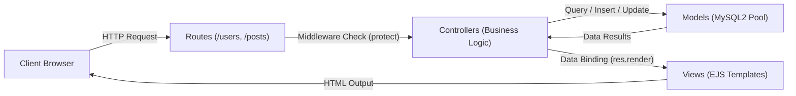
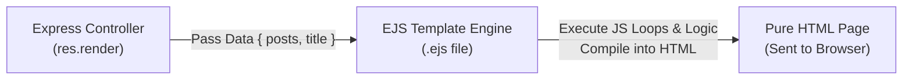
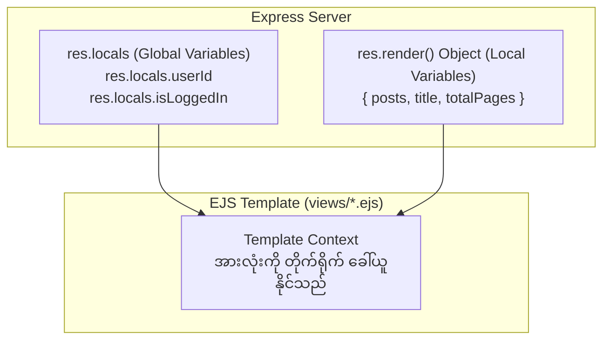
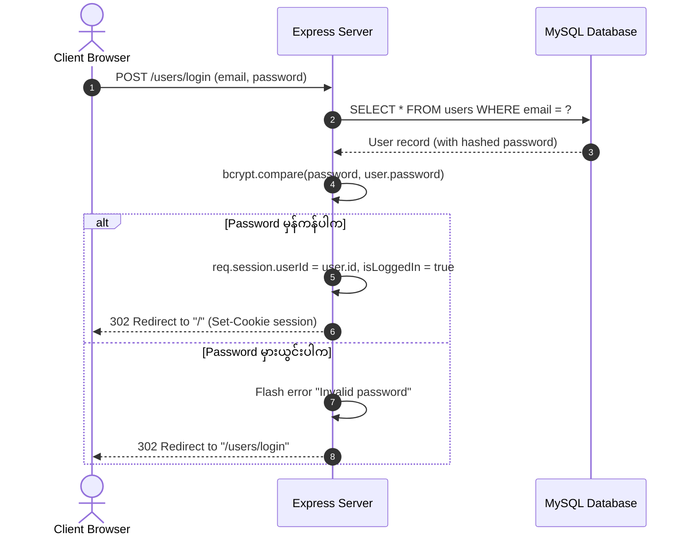
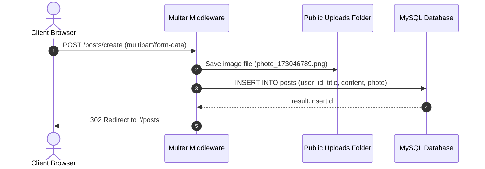

# Express & MySQL (SQL Express) Project - ကုဒ်လိုင်းတစ်ခုချင်းစီအလိုက် အသေးစိတ်ရှင်းလင်းချက်

ဤ Project သည် **Node.js, Express.js, MySQL2, EJS** တို့ကို အသုံးပြုပြီး **MVC (Model-View-Controller)** Architecture ဖြင့် စနစ်တကျ တည်ဆောက်ထားသော Web Application (User Authentication, Blog Post CRUD, Image Upload, Search & Pagination System) ဖြစ်ပါသည်။

---

## မာတိကာ (Table of Contents)
1. [Project Overview & Architecture](#၁-project-overview--architecture)
2. [Database Schema & Tables Structure (MySQL Design)](#၂-database-schema--tables-structure-mysql-design)
3. [Environment Variables (.env)](#၃-environment-variables-env)
4. [package.json & Dependencies](#၄-packagejson--dependencies)
5. [config/database.js (Database Connection Pool)](#၅-configdatabasejs-database-connection-pool)
6. [app.js (Main Entry Point & Middleware Pipeline)](#၆-appjs-main-entry-point--middleware-pipeline)
7. [middleware/auth.middleware.js (Authentication Guard)](#၇-middlewareauthmiddlewarejs-authentication-guard)
8. [helpers/functions.js (Flash Messages & Access Control)](#၈-helpersfunctionsjs-flash-messages--access-control)
9. [models/user.model.js (User Database Model)](#၉-modelsusermodeljs-user-database-model)
10. [models/post.model.js (Post Database Model & Pagination)](#၁၀-modelspostmodeljs-post-database-model--pagination)
11. [routes/user.routes.js (User Endpoints)](#၁၁-routesuserroutesjs-user-endpoints)
12. [routes/post.routes.js (Post Endpoints)](#၁၂-routespostroutesjs-post-endpoints)
13. [controllers/user.controller.js (User Business Logic)](#၁၃-controllersusercontrollerjs-user-business-logic)
14. [controllers/post.controller.js (Post CRUD, Upload & Search)](#၁၄-controllerspostcontrollerjs-post-crud-upload--search)
15. [EJS Syntax & Complete Guide (EJS အသုံးပြုနည်း အသေးစိတ်သင်ခန်းစာ)](#၁၅-ejs-syntax--complete-guide-ejs-အသုံးပြုနည်း-အသေးစိတ်သင်ခန်းစာ)
16. [views (Project ထဲရှိ EJS Templates များနှင့် UI အသေးစိတ်)](#၁၆-views-project-ထဲရှိ-ejs-templates-များနှင့်-ui-အသေးစိတ်)
17. [Data Flow & Request-Response Cycles (လုပ်ဆောင်ချက်အဆင့်ဆင့်)](#၁၇-data-flow--request-response-cycles-လုပ်ဆောင်ချက်အဆင့်ဆင့်)
18. [Security Best Practices (လုံခြုံရေးဆိုင်ရာ ထည့်သွင်းစဉ်းစားချက်များ)](#၁၈-security-best-practices-လုံခြုံရေးဆိုင်ရာ-ထည့်သွင်းစဉ်းစားချက်များ)
19. [Common Errors & Troubleshooting (အဖြစ်များသော အမှားများနှင့် ဖြေရှင်းနည်းများ)](#၁၉-common-errors--troubleshooting-အဖြစ်များသော-အမှားများနှင့်-ဖြေရှင်းနည်းများ)
20. [အကျဉ်းချုပ် (Summary)](#၂၀-အကျဉ်းချုပ်-summary)

---

## ၁. Project Overview & Architecture

Project ၏ အဓိက Folder Structure မှာ အောက်ပါအတိုင်း ဖြစ်ပါသည်-

```text
sqlexpress_project/
├── .env                     # Environment variables (DB credentials, Session secret, Port)
├── app.js                   # Express application စတင်ရာ Main Server file
├── package.json             # Project dependencies နှင့် scripts များ
├── config/
│   └── database.js          # MySQL2 Connection Pool တည်ဆောက်ခြင်း
├── middleware/
│   └── auth.middleware.js   # Route များကို Login ဝင်ထားသူသာ ဝင်ရောက်ခွင့်ပြုသော middleware
├── helpers/
│   └── functions.js         # Session Flash နှင့် User Access စစ်ဆေးပေးသော Helper functions
├── models/
│   ├── user.model.js        # Users table နှင့် ဆက်သွယ်လုပ်ဆောင်သော Database Queries
│   └── post.model.js        # Posts table နှင့် ဆက်သွယ်လုပ်ဆောင်သော Database Queries (Search & Pagination ပါဝင်)
├── routes/
│   ├── user.routes.js       # User ပိုင်းဆိုင်ရာ URL Endpoints (Routes)
│   └── post.routes.js       # Post ပိုင်းဆိုင်ရာ URL Endpoints (Routes)
├── controllers/
│   ├── user.controller.js   # User ဆိုင်ရာ Business Logic (Register, Login, Profile, Edit, etc.)
│   └── post.controller.js   # Post ဆိုင်ရာ Business Logic (CRUD, Image Upload, Search, Pagination)
├── public/
│   └── uploads/             # User တင်လိုက်သော ဓာတ်ပုံများ သိမ်းဆည်းရာ folder
└── views/                   # User မြင်တွေ့ရမည့် EJS UI Templates
    ├── index.ejs            # Home Page (Post များအား ပုံ၊ ရေးသားသူအမည်တို့ဖြင့် ပြသခြင်း)
    ├── partials/            # Header နှင့် Footer ကဲ့သို့ ဘုံသုံး template များ
    │   ├── header.ejs       # Navigation bar, Search bar နှင့် Auth ခလုတ်များ
    │   └── footer.ejs       # Copyright စာသားနှင့် Bootstrap JS Bundle script
    ├── posts/               # Posts စာရင်းနှင့် Post တင်ရန်/ပြင်ရန် form များ
    │   ├── list.ejs         # Post စာရင်းနှင့် Pagination ခလုတ်များ
    │   ├── create.ejs       # Post အသစ်တင်သည့် Form (File upload ပါဝင်)
    │   └── edit.ejs         # Post ပြင်ဆင်သည့် Form (လက်ရှိပုံ Preview ပါဝင်)
    └── user2/               # User Register, Login, Profile, Edit စာမျက်နှာများ
        ├── register.ejs     # အကောင့်သစ်ဖွင့် Form
        ├── login.ejs        # Login ဝင်သည့် Form
        ├── profile.ejs      # User Profile ကြည့်ရှုသည့် စာမျက်နှာ
        ├── edit.ejs         # User အချက်အလက် ပြင်ဆင်သည့် Form
        └── user.ejs         # စနစ်အတွင်းရှိ User အားလုံးစာရင်း
```

### MVC Architecture Diagram


---

## ၂. Database Schema & Tables Structure (MySQL Design)

ဤစနစ်တွင် MySQL Database အမည် `express_db` ကို အသုံးပြုထားပြီး အဓိက Table (၂) ခုဖြင့် ဖွဲ့စည်းထားပါသည်:

### ၁။ `users` Table
အသုံးပြုသူများ၏ အကောင့်အချက်အလက်များကို သိမ်းဆည်းသည့် Table ဖြစ်ပါသည်။

```sql
CREATE TABLE users (
  id INT AUTO_INCREMENT PRIMARY KEY,
  name VARCHAR(255) NOT NULL,
  email VARCHAR(255) NOT NULL UNIQUE,
  password VARCHAR(255) NOT NULL,
  create_time DATETIME DEFAULT CURRENT_TIMESTAMP
);
```

- **`id`**: User တစ်ဦးချင်းစီအတွက် မထပ်သော Primary Key (Auto Increment) ဖြစ်သည်။
- **`name`**: အသုံးပြုသူ၏ အမည်။
- **`email`**: Login ဝင်ရာတွင်သုံးသော အီးမေးလ်လိပ်စာ (`UNIQUE` ဖြစ်သောကြောင့် အီးမေးလ်တစ်ခုတည်းဖြင့် အကောင့်နှစ်ခု ဖွင့်၍မရပါ)။
- **`password`**: Plain text အဖြစ် မသိမ်းဘဲ `bcrypt` ဖြင့် Hash လုပ်ထားသော လျှို့ဝှက်စာသား (ဥပမာ: `$2b$10$...`)။
- **`create_time`**: အကောင့်ဖွင့်ခဲ့သော ရက်စွဲနှင့် အချိန်။

### ၂။ `posts` Table
Blog Post များနှင့် ပတ်သက်သော အချက်အလက်များ၊ ဓာတ်ပုံဖိုင်အမည်များကို သိမ်းဆည်းသည့် Table ဖြစ်ပါသည်။

```sql
CREATE TABLE posts (
  id INT AUTO_INCREMENT PRIMARY KEY,
  user_id INT NOT NULL,
  title VARCHAR(255) NOT NULL,
  content TEXT NOT NULL,
  photo VARCHAR(255) NULL,
  create_time DATETIME DEFAULT CURRENT_TIMESTAMP,
  FOREIGN KEY (user_id) REFERENCES users(id) ON DELETE CASCADE
);
```

- **`id`**: Post တစ်ခုချင်းစီ၏ Primary Key ဖြစ်သည်။
- **`user_id`**: ဤ Post ကို မည်သည့် User က ရေးသားခဲ့သည်ကို ညွှန်ပြသော Foreign Key ဖြစ်သည်။
- **`title`**: Post ၏ ခေါင်းစဉ်။
- **`content`**: Post ၏ အကြောင်းအရာ စာသား။
- **`photo`**: Multer ဖြင့် upload တင်လိုက်သော ဓာတ်ပုံဖိုင်အမည် (ဥပမာ: `photo_173046789.png`)။ ပုံမတင်ပါက `NULL` ဖြစ်သည်။
- **`create_time`**: Post တင်ခဲ့သော အချိန်။
- **Table ဆက်သွယ်ချက် (Relationship)**: **One-to-Many** (User တစ်ဦးသည် Post အများအပြား ရေးသားနိုင်သည်)။ `ON DELETE CASCADE` ထည့်ထားပါက User ကို ဖျက်လိုက်သည်နှင့် ထို User ရေးခဲ့သော Post များပါ အလိုအလျောက် ပျက်သွားမည် ဖြစ်သည်။

---

## ၃. Environment Variables (.env)

Database Password များနှင့် Session Secret များကဲ့သို့ လျှို့ဝှက်ချက်များကို Code ထဲတွင် တိုက်ရိုက် Hardcode မရေးဘဲ `.env` ဖိုင်တွင် ခွဲခြားသိမ်းဆည်းထားပါသည်။

```ini
# Application Port & Host
PORT = 3070
HOST = localhost
END_POINT = http://localhost:3070/

# MySQL Database Connection
DB_HOST = localhost
DB_USER = root
DB_PASS = your_db_password
DB_NAME = express_db

# Express Session Secret Key
SESSION_SECRET = secret_session_key_123
```

- **လုံခြုံရေး အကြံပြုချက်**: `.env` ဖိုင်ကို GitHub ကဲ့သို့ Public Repository များသို့ မတင်မိစေရန် `.gitignore` ထဲတွင် အမြဲ ထည့်သွင်းထားရပါမည်။

---

## ၄. package.json & Dependencies

`package.json` သည် Project အတွက် လိုအပ်သော library များ၊ script များနှင့် metadata များကို သတ်မှတ်ပေးသည့် ဖိုင်ဖြစ်ပါသည်။

```json
{
  "name": "sql-express",
  "version": "1.0.0",
  "main": "app.js",
  "scripts": {
    "dev": "nodemon app.js",
    "test": "echo \"Error: no test specified\" && exit 1"
  },
  "dependencies": {
    "bcrypt": "^5.1.1",
    "body-parser": "^1.20.2",
    "dotenv": "^16.4.5",
    "ejs": "^3.1.10",
    "express": "^4.19.2",
    "express-session": "^1.19.0",
    "helmet": "^8.1.0",
    "multer": "^1.4.5-lts.1",
    "mysql2": "^3.11.0"
  }
}
```

### Dependencies များ၏ အခန်းကဏ္ဍ:
- **`express`**: Routing, Middleware, Request/Response handling များကို စီမံပေးသည့် Web Framework ဖြစ်သည်။
- **`mysql2`**: MySQL database နှင့် ချိတ်ဆက်ပြီး SQL query များကို `async/await` (Promises) ဖြင့် run ပေးသည့် မြန်ဆန်သော driver ဖြစ်သည်။
- **`ejs` (Embedded JavaScript)**: Server-side မှ data များကို HTML ထဲသို့ bind ပေးသည့် Template Engine ဖြစ်သည်။
- **`bcrypt`**: Password များကို Hash လုပ်ခြင်းနှင့် Login ဝင်ရာတွင် Hash တူမတူ စစ်ဆေးပေးသည့် လုံခြုံရေး library ဖြစ်သည်။
- **`express-session`**: Server ပေါ်တွင် User login session သိမ်းဆည်းရန်နှင့် Browser သို့ Session Cookie ပို့ပေးရန် သုံးသည်။
- **`multer`**: Form မှ ပေးပို့လာသော File/Image Upload များကို လက်ခံပြီး Server disk ပေါ်တွင် သိမ်းဆည်းပေးသည့် middleware ဖြစ်သည်။
- **`helmet`**: HTTP Header လုံခြုံရေးဆိုင်ရာ ကာကွယ်မှုများ (Clickjacking, MIME sniffing စသည်) ကို အလိုအလျောက် တပ်ဆင်ပေးသည်။
- **`dotenv`**: `.env` ဖိုင်ထဲရှိ variables များကို `process.env` မှတစ်ဆင့် ဖတ်ယူအသုံးပြုစေသည်။

---

## ၅. config/database.js (Database Connection Pool)

Database နှင့် ချိတ်ဆက်ရန် Connection Pool တစ်ခုကို တည်ဆောက်ထားသည့် ဖိုင်ဖြစ်ပါသည်။

```javascript
const mysql = require("mysql2");

const pool = mysql.createPool({
  host: process.env.DB_HOST,
  user: process.env.DB_USER,
  password: process.env.DB_PASS,
  database: process.env.DB_NAME,
  waitForConnections: true,
  connectionLimit: 10,
  queueLimit: 0,
});

module.exports = pool.promise();
```

### လိုင်းချင်းစီ ရှင်းလင်းချက်:
- **`mysql.createPool({...})`**: Single Connection အစား Connection Pool ကို သုံးထားသည်။ Single Connection သည် request တစ်ခုချင်းစီအတွက် connection ဖွင့်/ပိတ်လုပ်ရသဖြင့် User များလာပါက နှေးကွေးတတ်သည်။ Pool သည် Connection ၁၀ ခုကို အသင့်ဖွင့်ထားပေးပြီး အလှည့်ကျ ပြန်လည်အသုံးပြု (Reuse) စေသည်။
  - `waitForConnections: true`: Connection ကုန်နေပါက လက်ရှိ run နေသော query ပြီးဆုံးသည်အထိ စောင့်ဆိုင်းစေသည်။
  - `connectionLimit: 10`: တစ်ပြိုင်နက်တည်း အများဆုံး connection ၁၀ ခု ထားရှိသည်။
  - `queueLimit: 0`: စောင့်ဆိုင်းရမည့် Query အရေအတွက်ကို ကန့်သတ်ချက်မထားဘဲ အားလုံးလက်ခံသည်။
- **`pool.promise()`**: Query များကို Callback function ရေးစရာမလိုဘဲ `const [rows] = await db.query(...)` ဟု `async/await` ဖြင့် သန့်ရှင်းစွာ ရေးသားနိုင်အောင် Promise Wrapper အဖြစ် export လုပ်ထားသည်။

---

## ၆. app.js (Main Entry Point & Middleware Pipeline)

Express application တစ်ခုလုံး၏ Configuration, Middleware များနှင့် Routes များကို ချိတ်ဆက်ပေးသည့် အဓိက ဖိုင်ဖြစ်ပါသည်။

```javascript
const express = require("express");
const app = express();
const path = require("path");
const dotenv = require("dotenv");
dotenv.config();
const helmet = require("helmet");
const session = require("express-session");
const Post = require("./models/post.model");
```

### Middleware Pipeline:
```javascript
// ၁။ Security Headers (Helmet)
app.use(
  helmet({
    contentSecurityPolicy: false, // Bootstrap CDN နှင့် ပြင်ပ script/style များ load လုပ်ခွင့်ပြုရန်
  })
);

// ၂။ Request Body Parsers
app.use(express.json()); // JSON format data parsing
app.use(express.urlencoded({ extended: true })); // Form submit (POST) data parsing

// ၃။ Static Files Folder
app.use(express.static("./public")); // public/uploads ထဲရှိ ပုံများကို browser မှ တိုက်ရိုက်ကြည့်ရှုခွင့်ပေးခြင်း

// ၄။ Session Configuration
app.use(
  session({
    secret: process.env.SESSION_SECRET || "secret_key_123",
    resave: false,
    saveUninitialized: false,
    cookie: {
      maxAge: 24 * 60 * 60 * 1000, // Session သက်တမ်း ၂၄ နာရီ
      httpOnly: true,              // JavaScript (XSS) မှ session cookie ကို ခိုးယူခွင့်မပြုခြင်း
    },
  })
);

// ၅။ Global View Variables Middleware
app.use((req, res, next) => {
  res.locals.userId = req.session.userId;
  res.locals.userName = req.session.userName;
  res.locals.isLoggedIn = req.session.isLoggedIn;
  next();
});

// ၆။ View Engine Setup
app.set("view engine", "ejs");
app.set("views", path.join(__dirname, "views"));
```

### Routes တပ်ဆင်ခြင်းနှင့် Home Route:
```javascript
const userRoutes = require("./routes/user.routes");
app.use("/users", userRoutes);

const postRoutes = require("./routes/post.routes");
app.use("/posts", postRoutes);

// Home Page Route (/)
app.get("/", async (req, res) => {
  try {
    const page = parseInt(req.query.page) || 1;
    const limit = 3;
    const offset = (page - 1) * limit;
    const posts = await Post.getAll(limit, offset);
    const totalPosts = await Post.countAll();
    const totalPages = Math.ceil(totalPosts / limit);
    res.render("index", {
      title: "Home",
      posts,
      currentPage: page,
      totalPages,
      baseUrl: "/",
    });
  } catch (error) {
    console.error("Error loading home page:", error);
    res.status(500).send("Server Error");
  }
});

const PORT = process.env.PORT || 3070;
const HOST = process.env.HOST || "localhost";
const END_POINT = process.env.END_POINT || `http://${HOST}:${PORT}`;

app.listen(PORT, () => {
  console.log(`Server is running on ${END_POINT}`);
});
```

- **`res.locals` Middleware ၏ အရေးပါပုံ**: `req.session.userId`, `userName`, `isLoggedIn` တန်ဖိုးများကို `res.locals` ထဲ ထည့်ပေးထားသောကြောင့် Controller တိုင်းမှ `header.ejs` သို့ သီးခြား pass စရာမလိုဘဲ Navigation bar တွင် Login ဝင်ထား/မထား အခြေအနေကို အလိုအလျောက် စစ်ဆေးပြသပေးနိုင်သည်။
- **Home Route (`/`)**: `Post.getAll()` ကို ခေါ်ယူပြီး တင်ထားသမျှ Post များကို ဓာတ်ပုံ၊ ရေးသားသူအမည်များနှင့်အတူ `views/index.ejs` သို့ ပို့ပေးသည်။

---

## ၇. middleware/auth.middleware.js (Authentication Guard)

Route များကို User Login ဝင်ထားမှသာ ဝင်ရောက်ကြည့်ရှုခွင့်ပေးသည့် Middleware ဖြစ်ပါသည်။

```javascript
// middleware/auth.middleware.js
const protect = (req, res, next) => {
  if (req.session.isLoggedIn) {
    next(); // Login ဝင်ထားပါက ဆက်လက်လုပ်ဆောင်ခွင့်ပြုသည်
  } else {
    res.redirect("/users/login"); // Login မဝင်ထားပါက Login page သို့ ချက်ချင်း redirect လုပ်သည်
  }
};

module.exports = { protect };
```

- Post တင်ခြင်း (`/posts/create`)၊ Post ပြင်ဆင်ခြင်း (`/posts/edit/:id`)၊ Post ဖျက်ခြင်း (`/posts/delete/:id`) နှင့် ကိုယ်ပိုင် Profile ကြည့်ခြင်း (`/users/profile/:id`) စသည့် Route များတွင် တပ်ဆင်အသုံးပြုသည်။

---

## ၈. helpers/functions.js (Flash Messages & Access Control)

Flash Message များနှင့် User Authorization စစ်ဆေးခြင်းအတွက် ပြန်လည်အသုံးပြုနိုင်သော Helper Functions များ ဖြစ်ပါသည်။

```javascript
const getSessionFlash = (req) => {
  const old = req.session ? req.session.old || {} : {};
  const message = req.session ? req.session.message || null : null;
  if (req.session) {
    delete req.session.old;
    delete req.session.message;
  }
  return { old, message };
};
```
- **`getSessionFlash`**: Form submit လုပ်ရာတွင် validation error (ဥပမာ: Password တိုလွန်းခြင်း) ဖြစ်ပါက အသုံးပြုသူ ရိုက်ထည့်ထားသော အချက်အလက်များ (`old`) နှင့် အမှားသတိပေးချက် (`message`) ကို Session မှ ထုတ်ယူပေးသည်။ ထုတ်ယူပြီးသည်နှင့် Session ထဲမှ ချက်ချင်း ဖျက်ပစ်သဖြင့် User သည် စာမျက်နှာကို Refresh လုပ်ပါက Error message ထပ်မံ မပေါ်တော့ပေ (Flash Message သဘောတရား)။

```javascript
const checkUserAccess = (req, res, user, viewPath, title) => {
  if (user === undefined || user.length === 0) {
    res.render(viewPath, {
      title,
      message: "User not found",
      old: null,
      user: null,
    });
    return false;
  }
  if (req.session.userId !== user.id) {
    res.render(viewPath, {
      title,
      message: "You are not authorized to view this profile",
      old: null,
      user: null,
    });
    return false;
  }
  return true;
};
```
- **`checkUserAccess`**: User A သည် User B ၏ Profile သို့မဟုတ် Edit စာမျက်နှာသို့ URL မှ ID ပြောင်းကာ တရားမဝင် ဝင်ရောက်ပြင်ဆင်ခြင်း မပြုနိုင်အောင် ကာကွယ်ပေးသည် (`req.session.userId !== user.id`)။

---

## ၉. models/user.model.js (User Database Model)

MySQL ၏ `users` table ပေါ်တွင် SQL Query များ စီမံခန့်ခွဲသည့် Class ဖြစ်ပါသည်။

```javascript
const db = require("../config/database");
const bcrypt = require("bcrypt");

class User {
  // ၁။ User အားလုံးကို ဆွဲထုတ်ခြင်း
  static async getAll() {
    try {
      const [users] = await db.query("SELECT * FROM users");
      return users;
    } catch (error) {
      console.error("Error fetching users:", error);
      throw error;
    }
  }

  // ၂။ User အသစ် ဖန်တီးခြင်း (Password Hashing ပါဝင်)
  static async create(name, email, password) {
    try {
      let oldUser = await User.findByEmail(email);
      if (oldUser) {
        throw new Error("User already exists");
      }
      const hashedPassword = await bcrypt.hash(password, 10);
      const [result] = await db.query(
        "INSERT INTO users (name, email, password, create_time) VALUES (?, ?, ?, ?)",
        [name, email, hashedPassword, new Date()]
      );
      return result.insertId;
    } catch (error) {
      console.error("Error creating user:", error);
      throw error;
    }
  }

  // ၃။ Email ဖြင့် User ရှာဖွေခြင်း
  static async findByEmail(email) {
    try {
      const [user] = await db.query("SELECT * FROM users WHERE email = ?", [email]);
      return user[0];
    } catch (error) {
      console.error("Error finding user by email:", error);
      throw error;
    }
  }

  // ၄။ ID ဖြင့် User ရှာဖွေခြင်း
  static async findById(id) {
    try {
      const [user] = await db.query("SELECT * FROM users WHERE id = ?", [id]);
      return user[0];
    } catch (error) {
      console.error("Error finding user by ID:", error);
      throw error;
    }
  }

  // ၅။ User အချက်အလက် ပြင်ဆင်ခြင်း
  static async update(id, name, email) {
    try {
      await db.query("UPDATE users SET name = ?, email = ? WHERE id = ?", [name, email, id]);
    } catch (error) {
      console.error("Error updating user:", error);
      throw error;
    }
  }

  // ၆။ User ဖျက်ခြင်း
  static async delete(id) {
    try {
      await db.query("DELETE FROM users WHERE id = ?", [id]);
    } catch (error) {
      console.error("Error deleting user:", error);
      throw error;
    }
  }
}

module.exports = User;
```

- **Prepared Statements (`?`)**: SQL Query တိုင်းတွင် တန်ဖိုးများကို တိုက်ရိုက် Concatenate မလုပ်ဘဲ `?` Placeholder ဖြင့် ပေးပို့ထားသောကြောင့် **SQL Injection Attack** ကို ၁၀၀% အပြည့်အဝ ကာကွယ်ပေးသည်။
- **Password Salt Rounds (10)**: `bcrypt.hash(password, 10)` သည် Password ကို ခန့်မှန်းရခက်ခဲသော Hash စာသားအဖြစ် ပြောင်းလဲပေးသည်။

---

## ၁၀. models/post.model.js (Post Database Model & Pagination)

MySQL ၏ `posts` table ပေါ်တွင် CRUD, Image Handling, Search နှင့် Pagination များကို ကိုင်တွယ်ဆောင်ရွက်သည့် Class ဖြစ်ပါသည်။

```javascript
const db = require("../config/database");

class Post {
  // ၁။ Post အားလုံးကို Author အမည်နှင့်တကွ ဆွဲထုတ်ခြင်း (Home Page အတွက်)
  static async getAll(limit, offset) {
    try {
      let sql =
        "SELECT posts.*, users.name AS author FROM posts LEFT JOIN users ON posts.user_id = users.id ORDER BY posts.id DESC";
      const params = [];
      if (limit !== undefined && offset !== undefined) {
        sql += " LIMIT ? OFFSET ?";
        params.push(Number(limit), Number(offset));
      }
      const [rows] = await db.query(sql, params);
      return rows;
    } catch (error) {
      console.error("Error fetching posts:", error);
      throw error;
    }
  }

  // ၂။ Login ဝင်ထားသော User ရေးခဲ့သည့် Post များကို Pagination ဖြင့် ဆွဲထုတ်ခြင်း
  static async getAuthorPosts(userId, limit = 5, offset = 0) {
    try {
      const [rows] = await db.query(
        "SELECT posts.*, users.name AS author FROM posts INNER JOIN users ON posts.user_id = users.id WHERE posts.user_id = ? ORDER BY posts.id DESC LIMIT ? OFFSET ?",
        [userId, Number(limit), Number(offset)]
      );
      return rows;
    } catch (error) {
      console.error("Error fetching author posts:", error);
      throw error;
    }
  }

  // ၃။ Post အသစ် ဖန်တီးခြင်း
  static async create(userId, title, content, photo) {
    const currentTime = new Date();
    try {
      const [result] = await db.query(
        "INSERT INTO posts (user_id, title, content, photo, create_time) VALUES (?, ?, ?, ?, ?)",
        [userId, title, content, photo, currentTime]
      );
      return result.insertId;
    } catch (error) {
      console.error("Error creating post:", error);
      throw error;
    }
  }

  // ၄။ Post ID ဖြင့် ရှာဖွေခြင်း
  static async findById(id) {
    try {
      const [rows] = await db.query(
        "SELECT posts.*, users.name AS author FROM posts JOIN users ON posts.user_id = users.id WHERE posts.id = ?",
        [id]
      );
      return rows[0];
    } catch (error) {
      console.error("Error finding post by ID:", error);
      throw error;
    }
  }

  // ၅။ Post ပြင်ဆင်ခြင်း
  static async update(id, title, content, photo) {
    try {
      await db.query(
        "UPDATE posts SET title = ?, content = ?, photo = ? WHERE id = ?",
        [title, content, photo, id]
      );
    } catch (error) {
      console.error("Error updating post:", error);
      throw error;
    }
  }

  // ၆။ Post ဖျက်ခြင်း
  static async delete(id) {
    try {
      await db.query("DELETE FROM posts WHERE id = ?", [id]);
    } catch (error) {
      console.error("Error deleting post:", error);
      throw error;
    }
  }

  // ၇။ Post ခေါင်းစဉ် သို့မဟုတ် စာသားဖြင့် ရှာဖွေခြင်း (Search & Pagination)
  static async search(query, limit = 5, offset = 0) {
    try {
      const [rows] = await db.query(
        `SELECT posts.*, users.name AS author FROM posts LEFT JOIN users ON posts.user_id = users.id WHERE posts.title LIKE ? OR posts.content LIKE ? ORDER BY posts.id DESC LIMIT ? OFFSET ?`,
        ["%" + query + "%", "%" + query + "%", Number(limit), Number(offset)]
      );
      return rows;
    } catch (error) {
      console.error("Error searching posts:", error);
      throw error;
    }
  }

  // ၈။ Post စုစုပေါင်း အရေအတွက် ရေတွက်ခြင်း
  static async countAll() {
    try {
      const [rows] = await db.query("SELECT COUNT(*) as count FROM posts");
      return rows[0].count;
    } catch (error) {
      console.error("Error counting posts:", error);
      throw error;
    }
  }

  // ၉။ သက်ဆိုင်ရာ Author ၏ Post စုစုပေါင်း အရေအတွက် ရေတွက်ခြင်း
  static async countAuthorPosts(userId) {
    try {
      const [rows] = await db.query(
        "SELECT COUNT(*) as count FROM posts WHERE user_id = ?",
        [userId]
      );
      return rows[0].count;
    } catch (error) {
      console.error("Error counting author posts:", error);
      throw error;
    }
  }

  // ၁၀။ Search ရလဒ် စုစုပေါင်း အရေအတွက် ရေတွက်ခြင်း
  static async countSearch(query) {
    try {
      const [rows] = await db.query(
        "SELECT COUNT(*) as count FROM posts WHERE title LIKE ? OR content LIKE ?",
        ["%" + query + "%", "%" + query + "%"]
      );
      return rows[0].count;
    } catch (error) {
      console.error("Error counting search posts:", error);
      throw error;
    }
  }
}

module.exports = Post;
```

### Pagination တွက်ချက်ပုံ သဘောတရား:
- **`limit`**: စာမျက်နှာတစ်ခုတွင် ပြသမည့် Post အရေအတွက် (ဥပမာ: `3`)။
- **`offset`**: စာမျက်နှာအလိုက် ကျော်ခွရမည့် Post အရေအတွက် `offset = (page - 1) * limit`။
  - စာမျက်နှာ ၁: `(1 - 1) * 3 = 0` (ပထမဆုံး ၃ ခု)
  - စာမျက်နှာ ၂: `(2 - 1) * 3 = 3` (၃ ခုကျော်ပြီး နောက် ၃ ခု)
- **`totalPages`**: `Math.ceil(totalPosts / limit)` ဖြင့် စုစုပေါင်း စာမျက်နှာအရေအတွက်ကို အပေါ်ကိန်းသို့ ပေါင်းတင်တွက်ချက်သည်။

---

## ၁၁. routes/user.routes.js (User Endpoints)

User ပိုင်းဆိုင်ရာ URL Endpoints များကို သတ်မှတ်ပေးသည့် ဖိုင်ဖြစ်ပါသည်။

```javascript
const express = require("express");
const router = express.Router();
const userController = require("../controllers/user.controller");
const { protect } = require("../middleware/auth.middleware");

// Prefix: /users
router.get("/", userController.allUsers);                              // GET  /users (User အားလုံးစာရင်း)
router.get("/register", userController.showRegisterForm);             // GET  /users/register (Register form)
router.post("/register", userController.register);                    // POST /users/register (Register submit)
router.get("/login", userController.showLoginForm);                   // GET  /users/login (Login form)
router.post("/login", userController.login);                          // POST /users/login (Login submit)
router.get("/logout", userController.logout);                         // GET  /users/logout (Logout session ဖျက်ခြင်း)
router.get("/profile/:id", protect, userController.showProfile);      // GET  /users/profile/:id (Profile ကြည့်ရန် - Login လိုအပ်)
router.get("/edit/:id", protect, userController.showEditForm);        // GET  /users/edit/:id (User ပြင်ဆင်ရန် Form - Login လိုအပ်)
router.post("/update/:id", userController.update);                    // POST /users/update/:id (Data ပြင်ဆင်ခြင်း)
router.post("/delete/:id", userController.delete);                    // POST /users/delete/:id (User ဖျက်ခြင်း)

module.exports = router;
```

---

## ၁၂. routes/post.routes.js (Post Endpoints)

Blog Post များနှင့် သက်ဆိုင်သော URL Endpoints များကို သတ်မှတ်ပေးသည့် ဖိုင်ဖြစ်ပါသည်။

```javascript
const express = require("express");
const postController = require("../controllers/post.controller");
const { protect } = require("../middleware/auth.middleware");

const router = express.Router();

// Prefix: /posts
router.get("/", protect, postController.index);                       // GET  /posts (Login ဝင်ထားသူ၏ Post များစာရင်း)
router.get("/create", protect, postController.showCreateForm);        // GET  /posts/create (Post တင်ရန် Form)
router.post("/create", protect, postController.create);               // POST /posts/create (Post အသစ် သိမ်းဆည်းခြင်း)
router.get("/edit/:id", protect, postController.showEditForm);        // GET  /posts/edit/:id (Post ပြင်ဆင်ရန် Form)
router.post("/update/:id", protect, postController.update);           // POST /posts/update/:id (Post အချက်အလက်နှင့် ပုံ Update)
router.post("/delete/:id", protect, postController.delete);           // POST /posts/delete/:id (Post ဖျက်ခြင်း)
router.get("/search", postController.search);                         // GET  /posts/search?q=xxx (Post ရှာဖွေခြင်း)

module.exports = router;
```

---

## ၁၃. controllers/user.controller.js (User Business Logic)

User Registration, Authentication, Profile Management လုပ်ငန်းစဉ်များကို ကိုင်တွယ်ဆောင်ရွက်သည့် Controller ဖြစ်ပါသည်။

### ၁။ အသုံးပြုသူများစာရင်း ပြသခြင်း (`allUsers`)
```javascript
exports.allUsers = async (_, res) => {
  const users = await User.getAll();
  res.render("user2/user", { users: users ?? [], title: "User Lists" });
};
```

### ၂။ Register ပြုလုပ်ခြင်း (`register`)
```javascript
exports.register = async (req, res) => {
  const { name, email, password } = req.body;

  // Validation: အမည်၊ အီးမေးလ်၊ စကားဝှက် မဖြစ်မနေ လိုအပ်သည်
  if (!name || name.trim().length === 0) { ... Flash: "Name Required" ... }
  if (!email || email.trim().length === 0) { ... Flash: "Email Required" ... }
  if (!password || password.length < 6) { ... Flash: "Password must be at least 6 characters" ... }

  // Email ရှိပြီးသားလား စစ်ဆေးခြင်း
  let user = await User.findByEmail(email);
  if (user) { ... Flash: "User already exists" ... }

  // Database ထဲသို့ ထည့်သွင်းခြင်း
  let result = await User.create(name, email, password);
  if (result) {
    res.redirect("/users/login");
  }
};
```

### ၃။ Login ဝင်ရောက်ခြင်း (`login`)
```javascript
exports.login = async (req, res) => {
  const { email, password } = req.body;
  // Validation စစ်ဆေးခြင်း...
  let user = await User.findByEmail(email);
  if (!user) { ... Flash: "Email Not Registered" ... }

  // Password တူမတူ bcrypt ဖြင့် နှိုင်းယှဉ်စစ်ဆေးခြင်း
  const isPasswordValid = await bcrypt.compare(password, user.password);
  if (!isPasswordValid) { ... Flash: "Invalid password" ... }

  // Login အောင်မြင်ပါက Session တည်ဆောက်ခြင်း:
  req.session.userId = user.id;
  req.session.userName = user.name;
  req.session.isLoggedIn = true;
  return res.redirect("/");
};
```

### ၄။ Profile ကြည့်ရှုခြင်းနှင့် Edit ပြုလုပ်ခြင်း (`showProfile` & `showEditForm`)
```javascript
exports.showProfile = async (req, res) => {
  const userId = req.params.id;
  const user = await User.findById(userId);

  // မိမိကိုယ်ပိုင် Profile ဟုတ်မဟုတ် Authorization စစ်ဆေးခြင်း
  if (!checkUserAccess(req, res, user, "user2/profile", "Profile")) {
    return;
  }
  const { old, message } = getSessionFlash(req);
  res.render("user2/profile", { user, title: "Profile", message, old });
};
```

### ၅။ Logout ထွက်ခြင်းနှင့် User အကောင့် ဖျက်ခြင်း (`logout` & `delete`)
```javascript
exports.delete = async (req, res) => {
  const userId = req.params.id;
  await User.delete(userId);
  return exports.logout(req, res);
};

exports.logout = async (req, res) => {
  if (req.session) {
    delete req.session.userId;
    delete req.session.userName;
    delete req.session.isLoggedIn;
  }
  res.redirect("/");
};
```

---

## ၁၄. controllers/post.controller.js (Post CRUD, Upload & Search)

Blog Post များ ပြသခြင်း၊ အသစ်တင်ခြင်း၊ ဓာတ်ပုံ Upload တင်ခြင်း၊ Pagination နှင့် Search တို့ကို စီမံခန့်ခွဲသည့် Controller ဖြစ်ပါသည်။

### ၁။ Multer Disk Storage ဖြင့် ပုံဖိုင် Upload ပြင်ဆင်ခြင်း
```javascript
const multer = require("multer");
const path = require("path");

const storage = multer.diskStorage({
  destination: "./public/uploads/", // Upload ပုံများကို သိမ်းဆည်းမည့် လမ်းကြောင်း
  filename: (_req, file, cb) => {
    // ဖိုင်အမည် မထပ်စေရန် photo_173046789.png ပုံစံဖြင့် နာမည်ပေးသည်
    cb(null, file.fieldname + "_" + Date.now() + path.extname(file.originalname));
  },
});

const upload = multer({ storage: storage }).single("photo");
```

### ၂။ User ၏ Post များ Pagination ဖြင့် ပြသခြင်း (`index`)
```javascript
exports.index = async (req, res) => {
  try {
    const userId = req.session.userId;
    const page = parseInt(req.query.page) || 1;
    const limit = 3;
    const offset = (page - 1) * limit;

    const posts = await Post.getAuthorPosts(userId, limit, offset);
    const totalPosts = await Post.countAuthorPosts(userId);
    const totalPages = Math.ceil(totalPosts / limit);

    res.render("posts/list", {
      posts: posts || [],
      title: "Post List",
      currentPage: page,
      totalPages,
      baseUrl: "/posts",
    });
  } catch (error) {
    console.error("Error fetching posts:", error);
    res.status(500).send("Server Error");
  }
};
```

### ၃။ Post အသစ် တင်ခြင်း (`create`)
```javascript
exports.create = async (req, res) => {
  upload(req, res, async (err) => {
    if (err) {
      console.error("Error uploading photo:", err);
      return res.status(500).send("Error uploading photo");
    }
    const { user_id, title, content } = req.body;
    // အကယ်၍ user က ပုံ upload တင်ခဲ့လျှင် file.filename ကို ယူပြီး မတင်ခဲ့လျှင် null ထားသည်
    const photo = req.file ? req.file.filename : null;
    try {
      await Post.create(user_id, title, content, photo);
      res.redirect("/posts");
    } catch (error) {
      console.error("Error creating post:", error);
      res.status(500).send("Server Error");
    }
  });
};
```

### ၄။ Post Edit ပြုလုပ်ခြင်းနှင့် Update လုပ်ခြင်း (`showEditForm` & `update`)
```javascript
exports.update = async (req, res) => {
  upload(req, res, async (err) => {
    if (err) return res.status(500).send("Error uploading photo");

    const { title, content, user_id, oldPhoto } = req.body;
    // ပုံအသစ် upload လုပ်ပါက ပုံအသစ်နာမည်ကို ယူပြီး၊ ပုံအသစ်မတင်ပါက မူရင်းပုံဟောင်း (oldPhoto) ကို ဆက်သုံးသည်
    const photo = req.file ? req.file.filename : oldPhoto;
    try {
      await Post.update(req.params.id, title, content, photo, user_id);
      res.redirect("/posts");
    } catch (error) {
      console.error("Error updating post:", error);
      res.status(500).send("Server Error");
    }
  });
};
```

### ၅။ Post Search ပြုလုပ်ခြင်း (`search`)
```javascript
exports.search = async (req, res) => {
  try {
    const q = req.query.q || "";
    const page = parseInt(req.query.page) || 1;
    const limit = 3;
    const offset = (page - 1) * limit;

    const posts = await Post.search(q, limit, offset);
    const totalPosts = await Post.countSearch(q);
    const totalPages = Math.ceil(totalPosts / limit);

    res.render("posts/list", {
      posts,
      title: `Search Results for '${q}'`,
      currentPage: page,
      totalPages,
      baseUrl: `/posts/search?q=${encodeURIComponent(q)}`,
    });
  } catch (error) {
    console.error("Error searching posts:", error);
    res.status(500).send("Server Error");
  }
};
```
- **URL Encoding**: Search query တွင် မြန်မာစာ သို့မဟုတ် Space များ ပါဝင်နိုင်သောကြောင့် `encodeURIComponent(q)` ဖြင့် လုံခြုံစွာ Encode လုပ်ပြီး Pagination link သို့ ပေးပို့သည်။

---

## ၁၅. EJS Syntax & Complete Guide (EJS အသုံးပြုနည်း အသေးစိတ်သင်ခန်းစာ)

**EJS (Embedded JavaScript)** သည် Node.js/Express တွင် အသုံးအများဆုံး **Server-Side Template Engine** တစ်ခု ဖြစ်ပါသည်။ ၎င်းသည် သမားရိုးကျ HTML ဖိုင်ထဲတွင် တကယ့် JavaScript Code များကို ထည့်သွင်းရေးသားနိုင်စေပြီး၊ Server က ထိုကုဒ်များကို run ပြီးမှသာ အချောသတ် HTML string အဖြစ် Client Browser သို့ ပြန်လည်ပေးပို့ (Server-Side Rendering - SSR) ပေးပါသည်။



---

### ၁။ EJS Tags (Delimiters) အားလုံးနှင့် အသုံးဝင်ပုံ နှိုင်းယှဉ်ချက်

EJS တွင် `<%` နှင့် `%>` အကြား ရေးသားသည့် Tag အမျိုးအစားပေါ် မူတည်၍ လုပ်ဆောင်ချက် ကွဲပြားပါသည်:

| Tag Syntax | နာမည် (Tag Type) | လုပ်ဆောင်ချက် | အသုံးပြုပုံ ဥပမာ |
| :--- | :--- | :--- | :--- |
| `<%= ... %>` | **Escaped Output** | တန်ဖိုးကို HTML Escape လုပ်ပြီး Template ထဲသို့ ထုတ်ပြသည် (XSS လုံခြုံသည်) | `<%= post.title %>` |
| `<%- ... %>` | **Unescaped Output** | တန်ဖိုးကို မူရင်းအတိုင်း Raw HTML အဖြစ် ထုတ်ပြသည် (Partials Include အတွက် သုံးသည်) | `<%- include('partials/header') %>` |
| `<% ... %>` | **Scriptlet Tag** | Control flow အတွက် JavaScript code သီးသန့် run သည် (Output ဘာမှမထွက်ပါ) | `<% if (isLoggedIn) { %>` |
| `<%# ... %>` | **Comment Tag** | EJS မှတ်ချက်ရေးရန်။ Browser ၏ View Source ထဲတွင် မပေါ်ပါ | `<%# ဤနေရာသည် မှတ်ချက်ဖြစ်သည် %>` |
| `<%_ ... _%>` | **Whitespace Slurping** | Tag အရှေ့နှင့် အနောက်ရှိ space/newline များကို ဖြတ်ထုတ်သည် | `<%_ if (test) { _%>` |
| `<% ... -%>` | **Trim Newline** | Tag ပြီးဆုံးသွားသည့်နောက်ရှိ line break (newline) ကို ဖြတ်ထုတ်သည် | `<% posts.forEach(p => { -%>` |
| `<%%` | **Literal Tag** | `<%` စာသားကို escape လုပ်ပြီး တကယ့်စာသားအဖြစ် ပြသလိုလျှင် သုံးသည် | `<%% if (showCode) %>` |

---

### ၂။ Output Tags နှိုင်းယှဉ်ချက် (`<%= %>` vs `<%- %>` - အလွန်အရေးကြီးသော လုံခြုံရေးသင်ခန်းစာ)

EJS ရေးသားရာတွင် `<%= %>` နှင့် `<%- %>` ၏ ကွာခြားချက်ကို မဖြစ်မနေ နားလည်ထားရပါမည်:

#### အခြေအနေ- အသုံးပြုသူက အောက်ပါ စာသားကို ရိုက်ထည့်လိုက်သည်:
```javascript
const userInput = "<script>alert('Hacked!');</script>";
```

1. **`<%= userInput %>` ကို သုံးပါက (Safe - အကြံပြုသည်):**
   - EJS က အန္တရာယ်ရှိသော HTML အမှတ်အသားများကို Entity အဖြစ် Escape လုပ်ပေးသည်:
     `&lt;script&gt;alert('Hacked!');&lt;/script&gt;`
   - Browser တွင် `<script>` tag အနေဖြင့် run မည်မဟုတ်ဘဲ ရိုးရိုးစာသား (Text) အနေဖြင့်သာ အန္တရာယ်ကင်းစွာ ပေါ်မည် ဖြစ်သည်။
   - **စည်းမျဉ်း**: User ရိုက်ထည့်ထားသော Data တိုင်း (Title, Content, Name, Email) ကို `<%= %>` ဖြင့်သာ အမြဲ ထုတ်ပြရပါမည်။

2. **`<%- userInput %>` ကို သုံးပါက (Unsafe - အန္တရာယ်ရှိသည်):**
   - EJS က မည်သည့် အကာအကွယ်မှ မပြုလုပ်ဘဲ Raw HTML အဖြစ် တိုက်ရိုက် ထုတ်ပေးသည်:
     `<script>alert('Hacked!');</script>`
   - Browser တွင် ဤ JavaScript code တကယ် run သွားပြီး **XSS (Cross-Site Scripting) Attack** ခံရမည် ဖြစ်သည်။
   - **စည်းမျဉ်း**: `<%- %>` ကို အခြား EJS Template များ ခေါ်ယူသည့်အခါ (`<%- include(...) %>`) သို့မဟုတ် QuillJS/Rich-Text Editor ကဲ့သို့ သင်ကိုယ်တိုင် စိတ်ချရသော Format ကျပြီးသား HTML များကို ပြသလိုသည့်အခါမှသာ သုံးရပါမည်။

---

### ၃။ Scriptlet Tag (`<% %>`) ဖြင့် Logic များ ရေးသားနည်း

`<% %>` အတွင်းတွင် မည်သည့် Standard JavaScript code ကိုမဆို ရေးသားနိုင်ပါသည်။

#### (က) `if / else if / else` အသုံးပြုနည်း:
```ejs
<% if (!isLoggedIn) { %>
  <li class="nav-item">
    <a class="nav-link" href="/users/login">Login</a>
  </li>
  <li class="nav-item">
    <a class="nav-link" href="/users/register">Register</a>
  </li>
<% } else { %>
  <li class="nav-item">
    <a class="nav-link" href="/users/profile/<%= userId %>">
      Profile (<%= userName %>)
    </a>
  </li>
  <li class="nav-item">
    <a class="nav-link" href="/users/logout">Logout</a>
  </li>
<% } %>
```
> [!NOTE]
> JavaScript ၏ ပိတ်ကွင်း `}` ကိုလည်း EJS tag `<% } %>` ထဲတွင် သီးခြား ပိတ်ပေးရပါမည်။ ပိတ်ကွင်း ကျန်ခဲ့ပါက `SyntaxError: Unexpected token` ဖြစ်ပေါ်ပါမည်။

#### (ခ) Ternary Operator (`condition ? true : false`) အသုံးပြုနည်း:
Bootstrap Class များကို အခြေအနေပေါ်မူတည်ပြီး Dynamic ထည့်သွင်းရာတွင် အလွန် အသုံးဝင်ပါသည်:
```ejs
<!-- Pagination Active Class သတ်မှတ်ခြင်း -->
<li class="page-item <%= (i === currentPage) ? 'active' : '' %>">
  <a class="page-link" href="/posts?page=<%= i %>"><%= i %></a>
</li>
```

#### (ဂ) `forEach` Loop ဖြင့် Array data များကို ပတ်ပြသခြင်း:
Controller မှ ပို့လိုက်သော Array (ဥပမာ: `posts`) ကို တစ်ခုချင်းစီ ထုတ်ယူပြသပုံ:
```ejs
<% if (posts && posts.length > 0) { %>
  <% posts.forEach(post => { %>
    <div class="card mb-3">
      <h2><%= post.title %></h2>
      <p><%= post.content %></p>
      <small>By <%= post.author %></small>
    </div>
  <% }) %>
<% } else { %>
  <p class="text-muted">No posts available.</p>
<% } %>
```

#### (ဃ) Classic `for` Loop ဖြင့် Pagination ပြသခြင်း:
```ejs
<ul class="pagination">
  <% for (let i = 1; i <= totalPages; i++) { %>
    <li class="page-item <%= i === currentPage ? 'active' : '' %>">
      <a class="page-link" href="/posts?page=<%= i %>"><%= i %></a>
    </li>
  <% } %>
</ul>
```

---

### ၄။ Safe Variable Checking (`ReferenceError` မဖြစ်အောင် ကာကွယ်နည်း)

Express နှင့် EJS ရေးသားရာတွင် အဖြစ်အများဆုံး Error မှာ Controller ဘက်မှ Variable တစ်ခုခု မပို့လိုက်မိသောအခါ EJS ဘက်တွင် တိုက်ရိုက်ခေါ်သုံးမိ၍ `ReferenceError: ... is not defined` ဖြစ်ပြီး Server Crash ဖြစ်သွားခြင်း ဖြစ်သည်။

#### မမှန်ကန်သော ပုံစံ (Dangerous):
```ejs
<!-- totalPages မပါလာပါက Server တန်းကျပါမည် -->
<% if (totalPages > 1) { %>
  ...
<% } %>
```

#### မှန်ကန်သော အကာအကွယ်ပုံစံများ (Safe):

1. **`typeof` Operator ဖြင့် စစ်ဆေးခြင်း (အကောင်းဆုံးနည်းလမ်း):**
   ```ejs
   <% if (typeof totalPages !== 'undefined' && totalPages > 1) { %>
     <!-- totalPages ရှိမှသာ ဤကုဒ် အလုပ်လုပ်မည် -->
     <p>Total Pages: <%= totalPages %></p>
   <% } %>
   ```

2. **`locals` Object မှတစ်ဆင့် စစ်ဆေးခြင်း:**
   EJS သို့ ပို့လိုက်သော variable အားလုံးသည် အလိုအလျောက် `locals` object ထဲတွင် ရှိနေပါသည်။ `locals.variableName` ဟု ခေါ်ပါက variable မရှိသော်လည်း Error မတက်ဘဲ `undefined` သာ return ပြန်ပေးပါသည်:
   ```ejs
   <!-- locals.old မရှိလျှင်လည်း Error မတက်ဘဲ empty string သာ ဖြစ်မည် -->
   <input type="text" name="name" value="<%= locals.old ? old.name || '' : '' %>" />
   ```

3. **Fallback Value သတ်မှတ်ခြင်း:**
   ```ejs
   <title><%= title || "Default Site Title" %></title>
   ```

---

### ၅။ Includes & Partials စနစ်တကျ အသုံးပြုနည်း

ထပ်ခါတလဲလဲ သုံးရသော UI အစိတ်အပိုင်းများ (Header, Footer, Navbar, Sidebar) ကို ဖိုင်ခွဲထုတ်ပြီး `include` ဖြင့် ပြန်လည် ချိတ်ဆက်အသုံးပြုနိုင်ပါသည်။

```ejs
<!-- views/index.ejs ထဲမှ ခေါ်ယူပုံ (ဖိုင်ချင်း Level တူပါက) -->
<%- include('partials/header') %>

<!-- views/posts/list.ejs ထဲမှ ခေါ်ယူပုံ (Subfolder ထဲ ရောက်နေပါက folder တစ်ဆင့် ပြန်တက်ရသည်) -->
<%- include('../partials/header') %>
```

> [!IMPORTANT]
> - `include()` ကို ခေါ်ယူရာတွင် ဖိုင် extension `.ejs` ကို ထည့်စရာ မလိုပါ။
> - Include ခေါ်ရာတွင် `<%=` မသုံးရပါ၊ အမြဲတမ်း `<%-` (Unescaped) ကို သုံးရပါမည်။ `<%=` သုံးမိပါက HTML tag များ ပျက်ပြားသွားပါမည်။

#### Partials ထဲသို့ Data ပေးပို့ခြင်း (Passing Data to Include):
```ejs
<!-- header သို့ custom title ပေးပို့ခြင်း -->
<%- include('../partials/header', { title: 'User Registration' }) %>
```

---

### ၆။ Express မှ EJS သို့ Data ပေးပို့ပုံ စနစ် (Data Scope)

Express တွင် EJS ဆီသို့ Data ပို့နိုင်သည့် နည်းလမ်း (၂) မျိုး ရှိပါသည်:



1. **`res.render("viewName", { ... })` (Local Variables):**
   - သက်ဆိုင်ရာ စာမျက်နှာ (View) တစ်ခုတည်းအတွက်သာ ရည်ရွယ်သော Data များ ဖြစ်သည် (ဥပမာ: Post List, Search Results, Form Old Values)။
2. **`res.locals` (Global View Variables):**
   - Middleware တစ်ခုတွင် ကြေညာထားရုံဖြင့် Project အတွင်းရှိ မည်သည့် EJS template ကမဆို တိုက်ရိုက် ခေါ်သုံးနိုင်သည် (ဥပမာ: `app.js` ရှိ `res.locals.isLoggedIn`, `res.locals.userId`)။

---

### ၇။ EJS အသုံးပြုရာတွင် အမှားများတတ်သည့် အချက်များ (Common Pitfalls)

| အမှား | အကျိုးဆက် | မှန်ကန်သော ဖြေရှင်းနည်း |
| :--- | :--- | :--- |
| `<% - include(...) %>` (Space ခြားမိခြင်း) | Include မလုပ်ဘဲ အနှုတ်လက္ခဏာ (Minus) အဖြစ် parse လုပ်သဖြင့် error တက်ခြင်း | `<%- include(...) %>` ဟု ကပ်ရေးရပါမည် |
| Tag ပိတ်ကွင်း `<% } %>` ကျန်ခဲ့ခြင်း | `SyntaxError: Unexpected token` ဖြစ်ပေါ်ခြင်း | If / Loop ပိတ်ကွင်းတိုင်းကို စစ်ဆေးပါ |
| User input ကို `<%- %>` ဖြင့် ထုတ်ပြခြင်း | XSS Vulnerability ဖြစ်ပေါ်ခြင်း | အမြဲတမ်း `<%= %>` ကိုသာ သုံးပါ |
| မကြေညာရသေးသော variable ကို တိုက်ရိုက်စစ်ခြင်း | `ReferenceError: ... is not defined` ဖြစ်ခြင်း | `typeof var !== 'undefined'` သို့မဟုတ် `locals.var` သုံးပါ |

---

## ၁၆. views (Project ထဲရှိ EJS Templates များနှင့် UI အသေးစိတ်)

Project အတွင်း လက်တွေ့ အသုံးပြုထားသော EJS Template ဖိုင်များနှင့် ၎င်းတို့၏ တည်ဆောက်ပုံများ ဖြစ်ပါသည်:

### ၁။ `views/partials/header.ejs`
- Bootstrap 5 CDN link ကို ချိတ်ဆက်ထားသည်။
- Post Search Bar ပါဝင်သည်:
  ```html
  <form action="/posts/search" method="GET" class="d-flex me-2">
    <input type="text" name="q" class="form-control" placeholder="Search Posts..">
    <button class="btn btn-primary">Search</button>
  </form>
  ```
- Session (`isLoggedIn`) အခြေအနေအလိုက် ပြောင်းလဲပြသပေးသည်:
  - **Login မဝင်ရသေးပါက**: `Login` နှင့် `Register` ခလုတ်များ။
  - **Login ဝင်ထားပါက**: `Create Post` ခလုတ်၊ `Post` စာရင်း၊ User နာမည် (Profile သို့ ချိတ်ထားသော link) နှင့် `Logout` ခလုတ်။
- Hero Banner Image (`/uploads/back2.jpg`) ကို စာမျက်နှာထိပ်တွင် ပြသပေးသည်။

### ၂။ `views/partials/footer.ejs`
- Copyright စာသားနှင့် Bootstrap 5 JS Bundle script (`bootstrap.bundle.min.js`) ပါဝင်သည်။
- HTML Tag များကို ပိတ်ပေးသည် (`</body></html>`)။ EJS စာမျက်နှာတိုင်း၏ အောက်ဆုံးတွင် Include လုပ်ရပါမည်။

### ၃။ `views/index.ejs` (Home Page)
- စနစ်အတွင်းရှိ Post အားလုံးကို ဓာတ်ပုံ၊ ခေါင်းစဉ်၊ ရေးသားသူအမည်နှင့် ရက်စွဲတို့ဖြင့် Bootstrap Card များဖြင့် ပြသပေးသည်:
  ```html
  <% if (post.photo) { %>
    <div class="mb-3">
      " alt="<%= post.title %>" class="img-fluid rounded" style="max-width: 400px; height: auto" />
    </div>
  <% } %>
  <h3><%= post.title %></h3>
  <p class="text-muted"><% if (post.author) { %>By <%= post.author %> &bull; <% } %> create time: <%= post.create_time %></p>
  <p><%= post.content %></p>
  ```

### ၄။ `views/posts/list.ejs` (Post Management & Pagination)
- User ၏ Post များကို ပြသပြီး Edit နှင့် Delete ပြုလုပ်နိုင်သော ခလုတ်များ ပါဝင်သည်။
- **Pagination Component**:
  ```html
  <div>
    <% if (typeof totalPages !== 'undefined' && totalPages > 1) { %>
      <nav aria-label="Page navigation example">
        <ul class="pagination justify-content-center">
          <% for (let i = 1; i <= totalPages; i++) { %>
            <li class="page-item <%= (typeof currentPage !== 'undefined' && i === currentPage) ? 'active' : '' %>">
              <a class="page-link" href="<%= baseUrl %><%= baseUrl.includes('?') ? '&' : '?' %>page=<%= i %>">
                <%= i %>
              </a>
            </li>
          <% } %>
        </ul>
      </nav>
    <% } %>
  </div>
  ```
  - `typeof totalPages !== 'undefined'` ဖြင့် စစ်ဆေးထားသောကြောင့် မည်သည့် route မှမဆို ဤ view ကို ခေါ်ယူလျှင် Variable မရှိ၍ Error တက်ခြင်း (ReferenceError) မှ ကာကွယ်ပေးသည်။
  - `baseUrl.includes('?') ? '&' : '?'` ဖြင့် URL တွင် Search parameter ပါ/မပါအလိုက် `?page=2` သို့မဟုတ် `&page=2` ကို အလိုအလျောက် မှန်ကန်စွာ ဆက်ပေးသည်။

### ၅။ `views/posts/create.ejs`
- `enctype="multipart/form-data"` ထည့်သွင်းထားသောကြောင့် ဖိုင်/ပုံ upload ပြုလုပ်နိုင်သည်။
- Session ထဲမှ Login ဝင်ထားသော `userId` ကို `<input type="hidden" value="<%=userId%>" name="user_id">` ဖြင့် Form ထဲတွင် အလိုအလျောက် ထည့်သွင်းပေးသည်။

### ၆။ `views/posts/edit.ejs`
- လက်ရှိတင်ထားသော ပုံဟောင်းကို Preview ပြပေးပြီး ပုံအသစ် မရွေးချယ်ပါက ပုံဟောင်း မပျောက်သွားစေရန် `<input type="hidden" name="oldPhoto" value="<%= post.photo %>">` ဖြင့် ထိန်းသိမ်းပေးထားသည်။

### ၇။ `views/user2/` (User Authentication Views)
- **`register.ejs` & `login.ejs`**: Validation error ဖြစ်ပါက Error message ကို ပြပေးပြီး ယခင်ရိုက်ထည့်ခဲ့သော data များကို `locals.old ? old.email : ''` ဖြင့် ပြန်လည်ဖြည့်သွင်းပေးထားသဖြင့် အသုံးပြုသူ အစမှ ပြန်ရိုက်စရာ မလိုပေ။
- **`profile.ejs`**: User Profile အချက်အလက်များ ကြည့်ရှုနိုင်ပြီး Edit/Delete ပြုလုပ်နိုင်သည်။
- **`user.ejs`**: စနစ်အတွင်းရှိ User အားလုံးစာရင်းကို ပြသပေးသည်။

---

## ၁၇. Data Flow & Request-Response Cycles (လုပ်ဆောင်ချက်အဆင့်ဆင့်)

### ၁။ User Login Flow


### ၂။ Post Creation with Image Upload Flow


---

## ၁၈. Security Best Practices (လုံခြုံရေးဆိုင်ရာ ထည့်သွင်းစဉ်းစားချက်များ)

ဤ Project တွင် ထည့်သွင်းတည်ဆောက်ထားသော လုံခြုံရေးကာကွယ်မှုများ:

1. **SQL Injection ကာကွယ်ခြင်း**:
   - Query တိုင်းတွင် Template String (ဥပမာ: `` `WHERE id = ${id}` ``) ကို လုံးဝ မသုံးဘဲ Prepared Statement Placeholders (`?`) များကို အသုံးပြုထားသည်။ MySQL Driver က အန္တရာယ်ရှိသော စာသားများကို အလိုအလျောက် Escape လုပ်ပေးသည်။
2. **Password လုံခြုံရေး**:
   - `bcrypt` ဖြင့် Salt rounds (10) ထည့်ကာ Hash ပြုလုပ်ထားသဖြင့် Database ပေါက်ကြားသွားလျှင်ပင် မူရင်း Password ကို မည်သူမျှ မသိရှိနိုင်ပေ။
3. **Cross-Site Scripting (XSS) ကာကွယ်ခြင်း**:
   - EJS တွင် `<%= %>` ကို သုံးထားသဖြင့် HTML tags များကို အလိုအလျောက် HTML Entity Escape လုပ်ပေးသည် (ဥပမာ: `<script>` ကို `&lt;script&gt;` အဖြစ် ပြောင်းပေးသည်)။
   - Session Cookie တွင် `httpOnly: true` ထားရှိသဖြင့် Malicious JavaScript မှ Session Cookie ကို ခိုးယူ၍ မရနိုင်ပေ။
4. **Session Hijacking ကာကွယ်ခြင်း**:
   - Session Secret ကို `.env` တွင် ထားရှိပြီး Cookie သက်တမ်းကို ၂၄ နာရီ ကန့်သတ်ထားသည်။
5. **HTTP Security Headers**:
   - `helmet` middleware ကို အသုံးပြုပြီး Browser Security Headers များကို လုံခြုံအောင် တပ်ဆင်ထားသည်။

---

## ၁၉. Common Errors & Troubleshooting (အဖြစ်များသော အမှားများနှင့် ဖြေရှင်းနည်းများ)

Project ရေးသားစဉ် သို့မဟုတ် Run စဉ် ကြုံတွေ့ရနိုင်သော အဓိက Error များနှင့် ဖြေရှင်းနည်းများ:

### ၁။ `Failed to lookup view "..." in views directory`
- **အကြောင်းအရင်း**: Controller ထဲတွင် ရေးထားသော View ဖိုင်အမည်နှင့် `views/` folder ထဲရှိ တကယ့် EJS ဖိုင်အမည် မတူညီခြင်း (ဥပမာ: `res.render("posts/list2")` ဟု ရေးထားသော်လည်း တကယ်ရှိသောဖိုင်မှာ `list.ejs` ဖြစ်နေခြင်း)။
- **ဖြေရှင်းနည်း**: Controller ရှိ View path ကို တကယ့်ဖိုင်အမည်နှင့် ကိုက်ညီအောင် ပြင်ဆင်ပါ (ဥပမာ: `res.render("posts/list")`)။

### ၂။ `ReferenceError: Cannot access '...' before initialization` (Temporal Dead Zone)
- **အကြောင်းအရင်း**: Import လုပ်ထားသော Model class အမည်နှင့် declare လုပ်နေသော variable အမည် တူနေခြင်း (ဥပမာ: `const posts = await posts.getAll(...)` ဟု ရေးမိခြင်း)။
- **ဖြေရှင်းနည်း**: Model class ကို စာလုံးကြီးဖြင့် ခေါ်ပါ: `const posts = await Post.getAll(...)`။ Model ကို အပေါ်ဆုံးတွင် import လုပ်ထားကြောင်း သေချာပါစေ (`const Post = require("./models/post.model");`)။

### ၃။ `ReferenceError: totalPages is not defined`
- **အကြောင်းအရင်း**: EJS ဖိုင်ထဲတွင် `<% if (totalPages && ...) %>` ဟု တိုက်ရိုက် ခေါ်ယူထားသော်လည်း Controller ဘက်မှ `totalPages` variable ကို pass မပေးလိုက်ခြင်း။
- **ဖြေရှင်းနည်း**: EJS တွင် စစ်ဆေးရာ၌ `typeof totalPages !== 'undefined'` ဟု စစ်ဆေးပါ။ Controller ဘက်မှလည်း လိုအပ်သော Pagination variable များကို မပျက်မကွက် ပို့ပေးပါ။

### ၄။ Database Connection Error (`ECONNREFUSED` / `Access denied for user`)
- **အကြောင်းအရင်း**: MySQL Server မဖွင့်ထားခြင်း သို့မဟုတ် `.env` ထဲရှိ `DB_USER`, `DB_PASS`, `DB_NAME` မှားယွင်းနေခြင်း။
- **ဖြေရှင်းနည်း**: MySQL Server (XAMPP / MySQL Service) run ထားကြောင်း စစ်ဆေးပြီး `.env` ဖိုင်ထဲရှိ User/Password/Database name များကို တိုက်ဆိုင်စစ်ဆေးပါ။

---

## ၂၀. အကျဉ်းချုပ် (Summary)

ဤ Project သည် Node.js/Express တွင် **MVC Pattern** ကို စံနမူနာပြ အသုံးပြုထားပြီး:
1. **Model** သည် MySQL Database Connection Pool ဖြင့် Database Queries (CRUD, Prepared Statements, Pagination Queries) များကို လုံခြုံမြန်ဆန်စွာ စီမံသည်။
2. **Controller** သည် လုပ်ငန်းစဉ် Logic များကို စစ်ဆေးလုပ်ဆောင်ပြီး Data များကို View သို့ ပို့ပေးသည်။
3. **View** သည် EJS ဖြင့် User မြင်တွေ့ရမည့် Responsive UI (Bootstrap 5) ကို ဖန်တီးပေးသည်။
4. **Middleware** ဖြင့် Session ကို စစ်ဆေးပြီး လုံခြုံရေးကာကွယ်မှု (`protect`, `bcrypt`, `helmet`, `getSessionFlash`) များကို စနစ်တကျ ထည့်သွင်းတည်ဆောက်ထားသောကြောင့် Production-ready Web Application တစ်ခု ဖြစ်ပါသည်။
